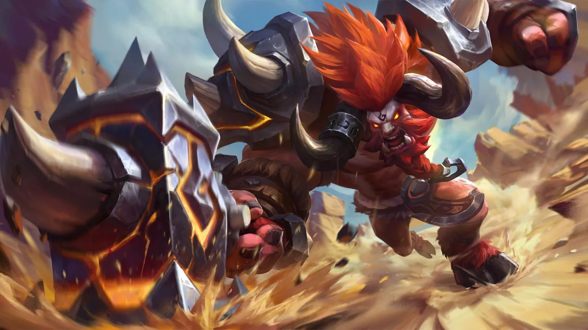

[All skins](https://boostmlbb.ru/en/skins/)

[Skins](https://boostmlbb.ru/en/skins/)/Minotaur

# Minotaur skins

Skins

6

In the shop

3

Latest

[Nether Overseer](https://boostmlbb.ru/en/skins/minotaur/nether-overseer.html)2026

[Hero profile→](https://boostmlbb.ru/en/heroes/minotaur.html)

## All skins

[Nether OverseerDeluxe · 2026](https://boostmlbb.ru/en/skins/minotaur/nether-overseer.html)[Dread­noughtExceptional · 2023](https://boostmlbb.ru/en/skins/minotaur/dreadnought.html)[TaurusDeluxe · 2019](https://boostmlbb.ru/en/skins/minotaur/taurus.html)[Sacred HammerCommon · 2018](https://boostmlbb.ru/en/skins/minotaur/sacred-hammer.html)[OrbiterCommon · 2018](https://boostmlbb.ru/en/skins/minotaur/orbiter.html)[Bursting YamaCommon · 2016](https://boostmlbb.ru/en/skins/minotaur/bursting-yama.html)

**How much is a rank boost on Minotaur?**Choose your current and target ranks to see the price here.

[Calculate price](https://boostmlbb.ru/en/order.html?type=hero)

## Frequently asked questions

How many skins does Minotaur have?

6 skins, the default look not counted. The newest is Nether Overseer (8 September 2026).

Which Minotaur skins can you buy now?

Nether Overseer (899 diamonds), Sacred Hammer (599 diamonds), Bursting Yama (399 diamonds). The other skins were limited and come back only in events.

What is the rarest Minotaur skin?

Nether Overseer, Deluxe class, Epic series. Sold in the skin shop for 899 diamonds.
