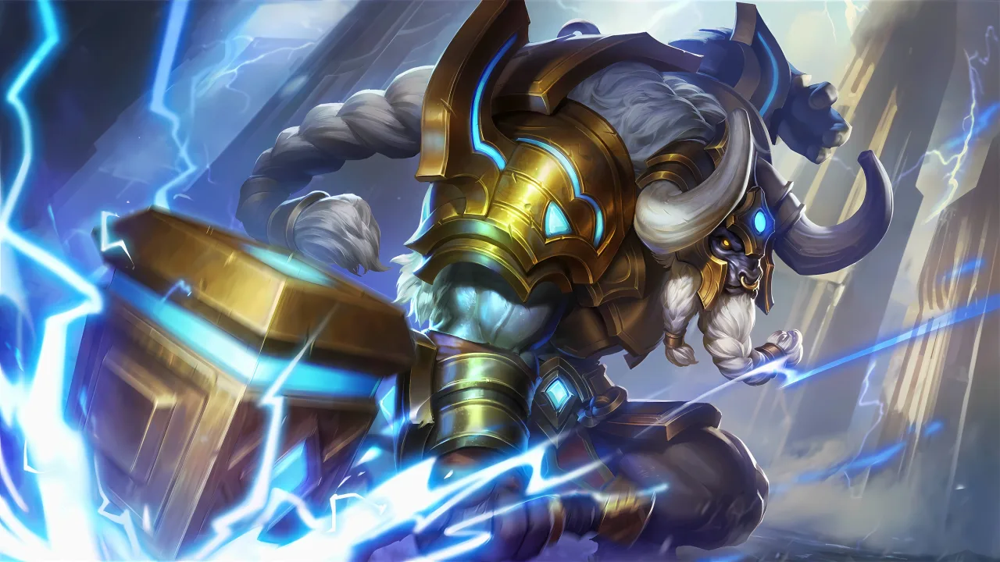

[Minotaur skins](https://boostmlbb.ru/en/skins/minotaur.html)

[Skins](https://boostmlbb.ru/en/skins/)/[Minotaur](https://boostmlbb.ru/en/skins/minotaur.html)/Orbiter

[Minotaur skin](https://boostmlbb.ru/en/skins/minotaur.html)

# Orbiter

CommonSeason 4Limited

How to get

Ranked Season 4 reward.

Released

2018

## What the skin changes

-   New look
-   Recoloured effects
-   Showcase animation
-   Attribute bonus

## All Minotaur skins [6](https://boostmlbb.ru/en/skins/minotaur.html)

[Nether OverseerDeluxe · 2026](https://boostmlbb.ru/en/skins/minotaur/nether-overseer.html)[Dread­noughtExceptional · 2023](https://boostmlbb.ru/en/skins/minotaur/dreadnought.html)[TaurusDeluxe · 2019](https://boostmlbb.ru/en/skins/minotaur/taurus.html)[Sacred HammerCommon · 2018](https://boostmlbb.ru/en/skins/minotaur/sacred-hammer.html)[OrbiterCommon · 2018](https://boostmlbb.ru/en/skins/minotaur/orbiter.html)[Bursting YamaCommon · 2016](https://boostmlbb.ru/en/skins/minotaur/bursting-yama.html)

**How much is a rank boost on Minotaur?**Choose your current and target ranks to see the price here.

[Calculate price](https://boostmlbb.ru/en/order.html?type=hero)

## Frequently asked questions

How to get the Orbiter skin for Minotaur?

Ranked Season 4 reward.

When was Orbiter released?

2018.

What class is Orbiter?

Common, Season 4 series.
