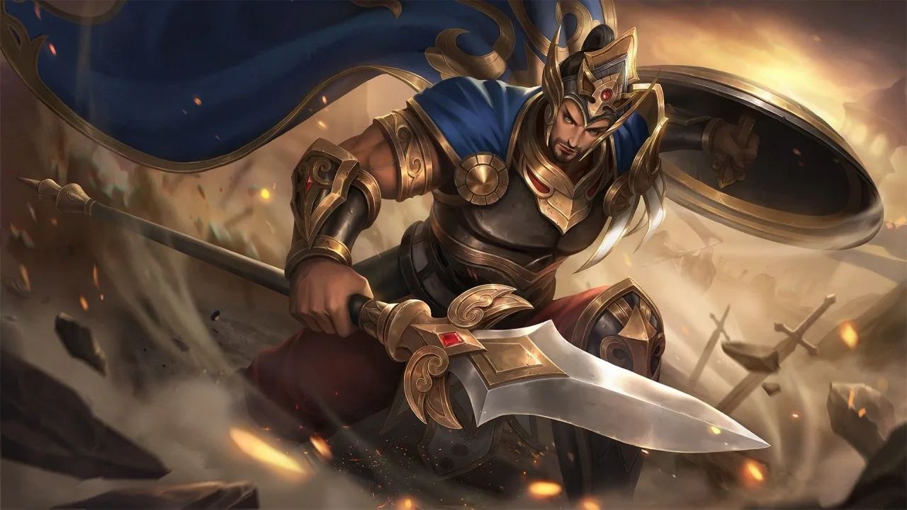

[Minsitthar skins](https://boostmlbb.ru/en/skins/minsitthar.html)

[Skins](https://boostmlbb.ru/en/skins/)/[Minsitthar](https://boostmlbb.ru/en/skins/minsitthar.html)/Gilded King

[Minsitthar skin](https://boostmlbb.ru/en/skins/minsitthar.html)

# Gilded King

CommonEliteIn the shop

How to get

Sold in the skin shop for 599 diamonds.

Price

599 diamonds

Released

1 March 2018

## What the skin changes

-   New look
-   Recoloured effects
-   Showcase animation
-   Attribute bonus

## All Minsitthar skins [5](https://boostmlbb.ru/en/skins/minsitthar.html)

[Symbol of ValorCommon · 2024](https://boostmlbb.ru/en/skins/minsitthar/symbol-of-valor.html)[Sol InvictusExquisite · 2024](https://boostmlbb.ru/en/skins/minsitthar/sol-invictus.html)[War LionExceptional · 2023](https://boostmlbb.ru/en/skins/minsitthar/war-lion.html)[King of WarCommon · 2022](https://boostmlbb.ru/en/skins/minsitthar/king-of-war.html)[Gilded KingCommon · 2018](https://boostmlbb.ru/en/skins/minsitthar/gilded-king.html)

## Elite series

[Golden OsmanthusChang'e · 2026](https://boostmlbb.ru/en/skins/change/golden-osmanthus.html)[Warlord KingMartis · 2025](https://boostmlbb.ru/en/skins/martis/warlord-king.html)[High Seas CadetKimmy · 2024](https://boostmlbb.ru/en/skins/kimmy/high-seas-cadet.html)[Verdant LancerSilvanna · 2024](https://boostmlbb.ru/en/skins/silvanna/verdant-lancer.html)[Bloodhoof MarauderHylos · 2024](https://boostmlbb.ru/en/skins/hylos/bloodhoof-marauder.html)[Elegant ButterflyGuinevere · 2024](https://boostmlbb.ru/en/skins/guinevere/elegant-butterfly.html)[Marques of BladesLancelot · 2024](https://boostmlbb.ru/en/skins/lancelot/marques-of-blades.html)[Badlands HiatusChip · 2024](https://boostmlbb.ru/en/skins/chip/badlands-hiatus.html)

**How much is a rank boost on Minsitthar?**Choose your current and target ranks to see the price here.

[Calculate price](https://boostmlbb.ru/en/order.html?type=hero)

## Frequently asked questions

How to get the Gilded King skin for Minsitthar?

Sold in the skin shop for 599 diamonds.

When was Gilded King released?

1 March 2018.

What class is Gilded King?

Common, Elite series.
