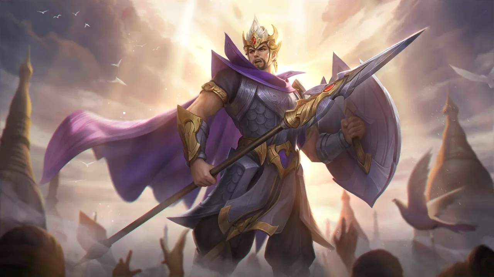
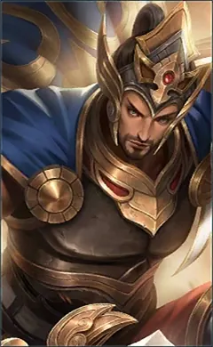

[Tier list](https://boostmlbb.ru/en/heroes/)[Items](https://boostmlbb.ru/en/items/)[Skins](https://boostmlbb.ru/en/skins/)[News & guides](https://boostmlbb.ru/en/news/)

[Skins](https://boostmlbb.ru/en/skins/)/[Minsitthar](https://boostmlbb.ru/en/skins/minsitthar.html)/King of War

[Minsitthar skin](https://boostmlbb.ru/en/skins/minsitthar.html)

# King of War

CommonIn the shop

How to get

Sold in the skin shop for 269 diamonds.

Price

269 diamonds

Released

22 February 2022

## What the skin changes

-   Attribute bonus

## All Minsitthar skins [5](https://boostmlbb.ru/en/skins/minsitthar.html)

[Symbol of ValorCommon · 2024](https://boostmlbb.ru/en/skins/minsitthar/symbol-of-valor.html)[Sol InvictusExquisite · 2024](https://boostmlbb.ru/en/skins/minsitthar/sol-invictus.html)[War LionExceptional · 2023](https://boostmlbb.ru/en/skins/minsitthar/war-lion.html)[King of WarCommon · 2022](https://boostmlbb.ru/en/skins/minsitthar/king-of-war.html)[Gilded KingCommon · 2018](https://boostmlbb.ru/en/skins/minsitthar/gilded-king.html)

**Rank up on Minsitthar**The calculator shows the price

[Calculate price](https://boostmlbb.ru/en/order.html?type=hero)

## Frequently asked questions

How to get the King of War skin for Minsitthar?

Sold in the skin shop for 269 diamonds.

When was King of War released?

22 February 2022.

What class is King of War?

Common.
