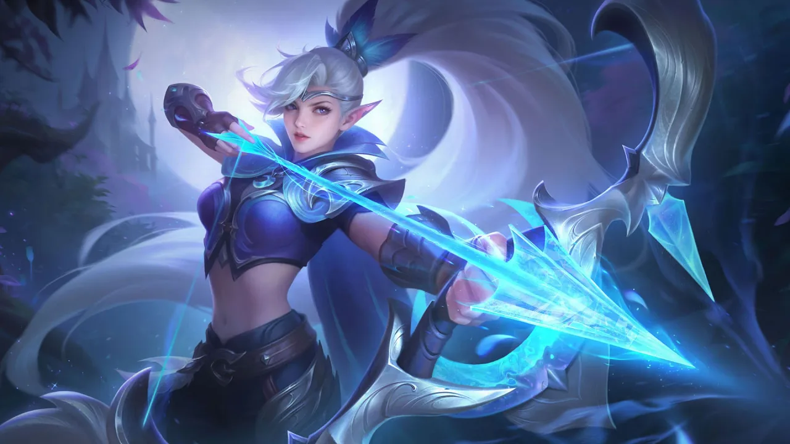

[Tier list](https://boostmlbb.ru/en/heroes/)[Items](https://boostmlbb.ru/en/items/)[Skins](https://boostmlbb.ru/en/skins/)[News & guides](https://boostmlbb.ru/en/news/)

[Skins](https://boostmlbb.ru/en/skins/)/Miya

# Miya skins

Skins

13

In the shop

3

Latest

[Arrow of Springs](https://boostmlbb.ru/en/skins/miya/arrow-of-springs.html)2026

[Hero profile→](https://boostmlbb.ru/en/heroes/miya.html)

## All skins

AllSupremeGrandExquisiteDeluxeExceptionalCommon

[Arrow of SpringsGrand · 2026](https://boostmlbb.ru/en/skins/miya/arrow-of-springs.html)[Nightowl HuntressExceptional · 2025](https://boostmlbb.ru/en/skins/miya/nightowl-huntress.html)[Atomic Pop MiyaDeluxe · 2023](https://boostmlbb.ru/en/skins/miya/atomic-pop-miya.html)[Doom CatalystExquisite · 2022](https://boostmlbb.ru/en/skins/miya/doom-catalyst.html)[Moon PriestessExceptional · 2021](https://boostmlbb.ru/en/skins/miya/moon-priestess.html)[Jungle RangerCommon · 2020](https://boostmlbb.ru/en/skins/miya/jungle-ranger.html)[SuzuhimeExceptional · 2018](https://boostmlbb.ru/en/skins/miya/suzuhime.html)[Sweet FantasyExceptional · 2018](https://boostmlbb.ru/en/skins/miya/sweet-fantasy.html)[HonorCommon · 2017](https://boostmlbb.ru/en/skins/miya/honor.html)[Modena ButterflySupreme · 2017](https://boostmlbb.ru/en/skins/miya/modena-butterfly.html)[Captain ThornsExceptional · 2017](https://boostmlbb.ru/en/skins/miya/captain-thorns.html)[Christmas CarnivalExquisite · 2016](https://boostmlbb.ru/en/skins/miya/christmas-carnival.html)[Burning BowCommon · 2016](https://boostmlbb.ru/en/skins/miya/burning-bow.html)

**Rank up on Miya**The calculator shows the price

[Calculate price](https://boostmlbb.ru/en/order.html?type=hero)

## Frequently asked questions

How many skins does Miya have?

13 skins, the default look not counted. The newest is Arrow of Springs (20 February 2026).

Which Miya skins can you buy now?

Honor (599 diamonds), Burning Bow (599 diamonds). The other skins were limited and come back only in events.

What is the rarest Miya skin?

Modena Butterfly, Supreme class, Legend series. Exchanged for 200 Magic Crystals from the Magic Wheel.
