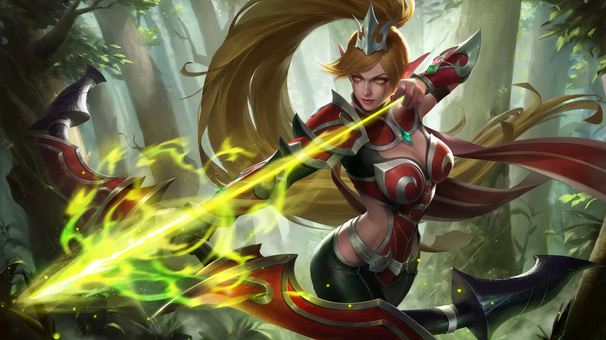

[Miya skins](https://boostmlbb.ru/en/skins/miya.html)

[Skins](https://boostmlbb.ru/en/skins/)/[Miya](https://boostmlbb.ru/en/skins/miya.html)/Burning Bow

[Miya skin](https://boostmlbb.ru/en/skins/miya.html)

# Burning Bow

CommonEliteIn the shop

How to get

Sold in the skin shop for 599 diamonds.

Price

599 diamonds

Released

2016

## Painted versions

The same skin in other colours. A painted version needs the skin itself.

-   **Tranquil Bow**StarLight reward for November 2019.

## All Miya skins [13](https://boostmlbb.ru/en/skins/miya.html)

[Arrow of SpringsGrand · 2026](https://boostmlbb.ru/en/skins/miya/arrow-of-springs.html)[Nightowl HuntressExceptional · 2025](https://boostmlbb.ru/en/skins/miya/nightowl-huntress.html)[Atomic Pop MiyaDeluxe · 2023](https://boostmlbb.ru/en/skins/miya/atomic-pop-miya.html)[Doom CatalystExquisite · 2022](https://boostmlbb.ru/en/skins/miya/doom-catalyst.html)[Moon PriestessExceptional · 2021](https://boostmlbb.ru/en/skins/miya/moon-priestess.html)[Jungle RangerCommon · 2020](https://boostmlbb.ru/en/skins/miya/jungle-ranger.html)[SuzuhimeExceptional · 2018](https://boostmlbb.ru/en/skins/miya/suzuhime.html)[Sweet FantasyExceptional · 2018](https://boostmlbb.ru/en/skins/miya/sweet-fantasy.html)[HonorCommon · 2017](https://boostmlbb.ru/en/skins/miya/honor.html)[Modena ButterflySupreme · 2017](https://boostmlbb.ru/en/skins/miya/modena-butterfly.html)[Captain ThornsExceptional · 2017](https://boostmlbb.ru/en/skins/miya/captain-thorns.html)[Christmas CarnivalExquisite · 2016](https://boostmlbb.ru/en/skins/miya/christmas-carnival.html)[Burning BowCommon · 2016](https://boostmlbb.ru/en/skins/miya/burning-bow.html)

## Elite series

[Golden OsmanthusChang'e · 2026](https://boostmlbb.ru/en/skins/change/golden-osmanthus.html)[Warlord KingMartis · 2025](https://boostmlbb.ru/en/skins/martis/warlord-king.html)[High Seas CadetKimmy · 2024](https://boostmlbb.ru/en/skins/kimmy/high-seas-cadet.html)[Verdant LancerSilvanna · 2024](https://boostmlbb.ru/en/skins/silvanna/verdant-lancer.html)[Bloodhoof MarauderHylos · 2024](https://boostmlbb.ru/en/skins/hylos/bloodhoof-marauder.html)[Elegant ButterflyGuinevere · 2024](https://boostmlbb.ru/en/skins/guinevere/elegant-butterfly.html)[Marques of BladesLancelot · 2024](https://boostmlbb.ru/en/skins/lancelot/marques-of-blades.html)[Badlands HiatusChip · 2024](https://boostmlbb.ru/en/skins/chip/badlands-hiatus.html)

**How much is a rank boost on Miya?**Choose your current and target ranks to see the price here.

[Calculate price](https://boostmlbb.ru/en/order.html?type=hero)

## Frequently asked questions

How to get the Burning Bow skin for Miya?

Sold in the skin shop for 599 diamonds.

When was Burning Bow released?

2016.

What class is Burning Bow?

Common, Elite series.
