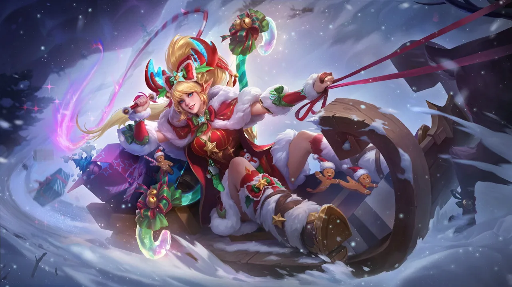

[Miya skins](https://boostmlbb.ru/en/skins/miya.html)

[Skins](https://boostmlbb.ru/en/skins/)/[Miya](https://boostmlbb.ru/en/skins/miya.html)/Christmas Carnival

[Miya skin](https://boostmlbb.ru/en/skins/miya.html)

# Christmas Carnival

ExquisiteLuckyboxLimited

How to get

Came out of Lucky Boxes in events. Limited skins come back in event draws from time to time.

Released

11 December 2016

## All Miya skins [13](https://boostmlbb.ru/en/skins/miya.html)

[Arrow of SpringsGrand · 2026](https://boostmlbb.ru/en/skins/miya/arrow-of-springs.html)[Nightowl HuntressExceptional · 2025](https://boostmlbb.ru/en/skins/miya/nightowl-huntress.html)[Atomic Pop MiyaDeluxe · 2023](https://boostmlbb.ru/en/skins/miya/atomic-pop-miya.html)[Doom CatalystExquisite · 2022](https://boostmlbb.ru/en/skins/miya/doom-catalyst.html)[Moon PriestessExceptional · 2021](https://boostmlbb.ru/en/skins/miya/moon-priestess.html)[Jungle RangerCommon · 2020](https://boostmlbb.ru/en/skins/miya/jungle-ranger.html)[SuzuhimeExceptional · 2018](https://boostmlbb.ru/en/skins/miya/suzuhime.html)[Sweet FantasyExceptional · 2018](https://boostmlbb.ru/en/skins/miya/sweet-fantasy.html)[HonorCommon · 2017](https://boostmlbb.ru/en/skins/miya/honor.html)[Modena ButterflySupreme · 2017](https://boostmlbb.ru/en/skins/miya/modena-butterfly.html)[Captain ThornsExceptional · 2017](https://boostmlbb.ru/en/skins/miya/captain-thorns.html)[Christmas CarnivalExquisite · 2016](https://boostmlbb.ru/en/skins/miya/christmas-carnival.html)[Burning BowCommon · 2016](https://boostmlbb.ru/en/skins/miya/burning-bow.html)

## Luckybox series

[Lady CraneGuinevere · 2025](https://boostmlbb.ru/en/skins/guinevere/lady-crane.html)[Butterfly SeraphimLunox · 2025](https://boostmlbb.ru/en/skins/lunox/butterfly-seraphim.html)[Mecha DragonClaude · 2025](https://boostmlbb.ru/en/skins/claude/mecha-dragon.html)[Lunar MagicChang'e · 2020](https://boostmlbb.ru/en/skins/change/lunar-magic.html)[Thunder FlashSelena · 2020](https://boostmlbb.ru/en/skins/selena/thunder-flash.html)[RaksheshaHanabi · 2020](https://boostmlbb.ru/en/skins/hanabi/rakshesha.html)[Video-Game DominatorUranus · 2020](https://boostmlbb.ru/en/skins/uranus/video-game-dominator.html)[God of WarMartis · 2020](https://boostmlbb.ru/en/skins/martis/god-of-war.html)

**How much is a rank boost on Miya?**Choose your current and target ranks to see the price here.

[Calculate price](https://boostmlbb.ru/en/order.html?type=hero)

## Frequently asked questions

How to get the Christmas Carnival skin for Miya?

Came out of Lucky Boxes in events. Limited skins come back in event draws from time to time.

When was Christmas Carnival released?

11 December 2016.

What class is Christmas Carnival?

Exquisite, Luckybox series.
