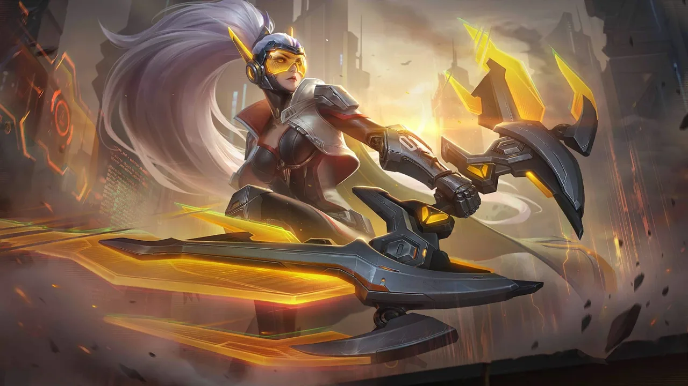
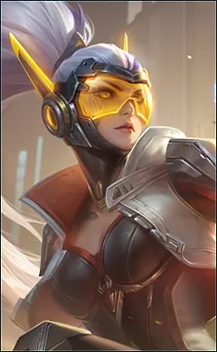
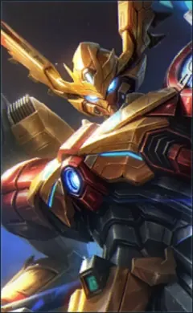

[Miya skins](https://boostmlbb.ru/en/skins/miya.html)

[Skins](https://boostmlbb.ru/en/skins/)/[Miya](https://boostmlbb.ru/en/skins/miya.html)/Doom Catalyst

[Miya skin](https://boostmlbb.ru/en/skins/miya.html)

# Doom Catalyst

ExquisiteCollectorLimited

How to get

The top prize of a Collector event draw, paid with diamonds. Limited skins come back in event draws from time to time.

Released

September 2022

## All Miya skins [13](https://boostmlbb.ru/en/skins/miya.html)

[Arrow of SpringsGrand · 2026](https://boostmlbb.ru/en/skins/miya/arrow-of-springs.html)[Nightowl HuntressExceptional · 2025](https://boostmlbb.ru/en/skins/miya/nightowl-huntress.html)[Atomic Pop MiyaDeluxe · 2023](https://boostmlbb.ru/en/skins/miya/atomic-pop-miya.html)[Doom CatalystExquisite · 2022](https://boostmlbb.ru/en/skins/miya/doom-catalyst.html)[Moon PriestessExceptional · 2021](https://boostmlbb.ru/en/skins/miya/moon-priestess.html)[Jungle RangerCommon · 2020](https://boostmlbb.ru/en/skins/miya/jungle-ranger.html)[SuzuhimeExceptional · 2018](https://boostmlbb.ru/en/skins/miya/suzuhime.html)[Sweet FantasyExceptional · 2018](https://boostmlbb.ru/en/skins/miya/sweet-fantasy.html)[HonorCommon · 2017](https://boostmlbb.ru/en/skins/miya/honor.html)[Modena ButterflySupreme · 2017](https://boostmlbb.ru/en/skins/miya/modena-butterfly.html)[Captain ThornsExceptional · 2017](https://boostmlbb.ru/en/skins/miya/captain-thorns.html)[Christmas CarnivalExquisite · 2016](https://boostmlbb.ru/en/skins/miya/christmas-carnival.html)[Burning BowCommon · 2016](https://boostmlbb.ru/en/skins/miya/burning-bow.html)

## Collector series

[The PurifierBruno · 2026](https://boostmlbb.ru/en/skins/bruno/the-purifier.html)[Celestial RebelSun · 2026](https://boostmlbb.ru/en/skins/sun/celestial-rebel.html)[Kaiju of the DeepHelcurt · 2026](https://boostmlbb.ru/en/skins/helcurt/kaiju-of-the-deep.html)[Starbound SentryKimmy · 2026](https://boostmlbb.ru/en/skins/kimmy/starbound-sentry.html)[Dreaming MonarchAlice · 2026](https://boostmlbb.ru/en/skins/alice/dreaming-monarch.html)[Tremor of the DeepGrock · 2026](https://boostmlbb.ru/en/skins/grock/tremor-of-the-deep.html)[Celestial GeneralTigreal · 2026](https://boostmlbb.ru/en/skins/tigreal/celestial-general.html)[Sunborn MonarchXavier · 2026](https://boostmlbb.ru/en/skins/xavier/sunborn-monarch.html)

**How much is a rank boost on Miya?**Choose your current and target ranks to see the price here.

[Calculate price](https://boostmlbb.ru/en/order.html?type=hero)

## Frequently asked questions

How to get the Doom Catalyst skin for Miya?

The top prize of a Collector event draw, paid with diamonds. Limited skins come back in event draws from time to time.

When was Doom Catalyst released?

September 2022.

What class is Doom Catalyst?

Exquisite, Collector series.
