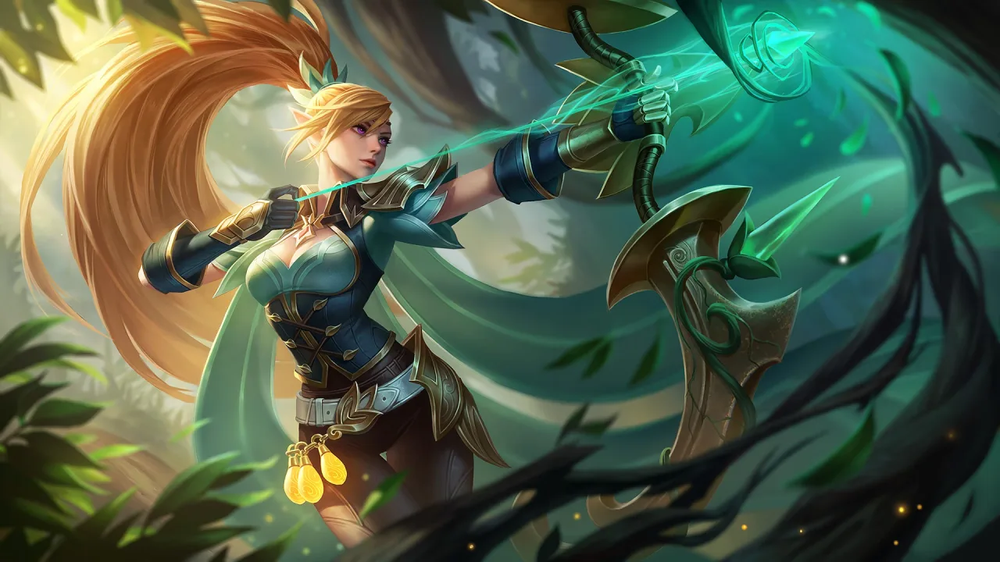
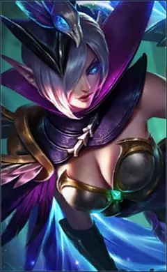

[Tier list](https://boostmlbb.ru/en/heroes/)[Items](https://boostmlbb.ru/en/items/)[Skins](https://boostmlbb.ru/en/skins/)[News & guides](https://boostmlbb.ru/en/news/)

[Skins](https://boostmlbb.ru/en/skins/)/[Miya](https://boostmlbb.ru/en/skins/miya.html)/Jungle Ranger

[Miya skin](https://boostmlbb.ru/en/skins/miya.html)

# Jungle Ranger

CommonLimited

How to get

Price at release: 50 diamonds. Not sold in the shop now: it comes back only in events. First top-up gift in Season 18.

Price

50 diamonds

Released

30 September 2020

## All Miya skins [13](https://boostmlbb.ru/en/skins/miya.html)

[Arrow of SpringsGrand · 2026](https://boostmlbb.ru/en/skins/miya/arrow-of-springs.html)[Nightowl HuntressExceptional · 2025](https://boostmlbb.ru/en/skins/miya/nightowl-huntress.html)[Atomic Pop MiyaDeluxe · 2023](https://boostmlbb.ru/en/skins/miya/atomic-pop-miya.html)[Doom CatalystExquisite · 2022](https://boostmlbb.ru/en/skins/miya/doom-catalyst.html)[Moon PriestessExceptional · 2021](https://boostmlbb.ru/en/skins/miya/moon-priestess.html)[Jungle RangerCommon · 2020](https://boostmlbb.ru/en/skins/miya/jungle-ranger.html)[SuzuhimeExceptional · 2018](https://boostmlbb.ru/en/skins/miya/suzuhime.html)[Sweet FantasyExceptional · 2018](https://boostmlbb.ru/en/skins/miya/sweet-fantasy.html)[HonorCommon · 2017](https://boostmlbb.ru/en/skins/miya/honor.html)[Modena ButterflySupreme · 2017](https://boostmlbb.ru/en/skins/miya/modena-butterfly.html)[Captain ThornsExceptional · 2017](https://boostmlbb.ru/en/skins/miya/captain-thorns.html)[Christmas CarnivalExquisite · 2016](https://boostmlbb.ru/en/skins/miya/christmas-carnival.html)[Burning BowCommon · 2016](https://boostmlbb.ru/en/skins/miya/burning-bow.html)

**Rank up on Miya**The calculator shows the price

[Calculate price](https://boostmlbb.ru/en/order.html?type=hero)

## Frequently asked questions

How to get the Jungle Ranger skin for Miya?

Price at release: 50 diamonds. Not sold in the shop now: it comes back only in events. First top-up gift in Season 18.

When was Jungle Ranger released?

30 September 2020.

What class is Jungle Ranger?

Common.
