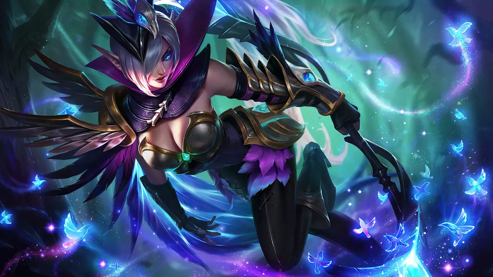

[Miya skins](https://boostmlbb.ru/en/skins/miya.html)

[Skins](https://boostmlbb.ru/en/skins/)/[Miya](https://boostmlbb.ru/en/skins/miya.html)/Modena Butterfly

[Miya skin](https://boostmlbb.ru/en/skins/miya.html)

# Modena Butterfly

SupremeLegendIn the shop

How to get

Exchanged for 200 Magic Crystals from the Magic Wheel.

Price

200 Magic Crystals

Released

19 September 2017

## All Miya skins [13](https://boostmlbb.ru/en/skins/miya.html)

[Arrow of SpringsGrand · 2026](https://boostmlbb.ru/en/skins/miya/arrow-of-springs.html)[Nightowl HuntressExceptional · 2025](https://boostmlbb.ru/en/skins/miya/nightowl-huntress.html)[Atomic Pop MiyaDeluxe · 2023](https://boostmlbb.ru/en/skins/miya/atomic-pop-miya.html)[Doom CatalystExquisite · 2022](https://boostmlbb.ru/en/skins/miya/doom-catalyst.html)[Moon PriestessExceptional · 2021](https://boostmlbb.ru/en/skins/miya/moon-priestess.html)[Jungle RangerCommon · 2020](https://boostmlbb.ru/en/skins/miya/jungle-ranger.html)[SuzuhimeExceptional · 2018](https://boostmlbb.ru/en/skins/miya/suzuhime.html)[Sweet FantasyExceptional · 2018](https://boostmlbb.ru/en/skins/miya/sweet-fantasy.html)[HonorCommon · 2017](https://boostmlbb.ru/en/skins/miya/honor.html)[Modena ButterflySupreme · 2017](https://boostmlbb.ru/en/skins/miya/modena-butterfly.html)[Captain ThornsExceptional · 2017](https://boostmlbb.ru/en/skins/miya/captain-thorns.html)[Christmas CarnivalExquisite · 2016](https://boostmlbb.ru/en/skins/miya/christmas-carnival.html)[Burning BowCommon · 2016](https://boostmlbb.ru/en/skins/miya/burning-bow.html)

## Legend series

[Revenant of RosesAlpha · 2025](https://boostmlbb.ru/en/skins/alpha/revenant-of-roses.html)[Sovereign of RealmsJohnson · 2025](https://boostmlbb.ru/en/skins/johnson/sovereign-of-realms.html)[Galactic VanquisherFreya · 2024](https://boostmlbb.ru/en/skins/freya/galactic-vanquisher.html)[Divine GoddessLunox · 2023](https://boostmlbb.ru/en/skins/lunox/divine-goddess.html)[King of HellFranco · 2023](https://boostmlbb.ru/en/skins/franco/king-of-hell.html)[Psion of TomorrowGuinevere · 2022](https://boostmlbb.ru/en/skins/guinevere/psion-of-tomorrow.html)[Infernal BlazeValir · 2022](https://boostmlbb.ru/en/skins/valir/infernal-blaze.html)[Cosmic GleamGusion · 2022](https://boostmlbb.ru/en/skins/gusion/cosmic-gleam.html)

**How much is a rank boost on Miya?**Choose your current and target ranks to see the price here.

[Calculate price](https://boostmlbb.ru/en/order.html?type=hero)

## Frequently asked questions

How to get the Modena Butterfly skin for Miya?

Exchanged for 200 Magic Crystals from the Magic Wheel.

When was Modena Butterfly released?

19 September 2017.

What class is Modena Butterfly?

Supreme, Legend series.
