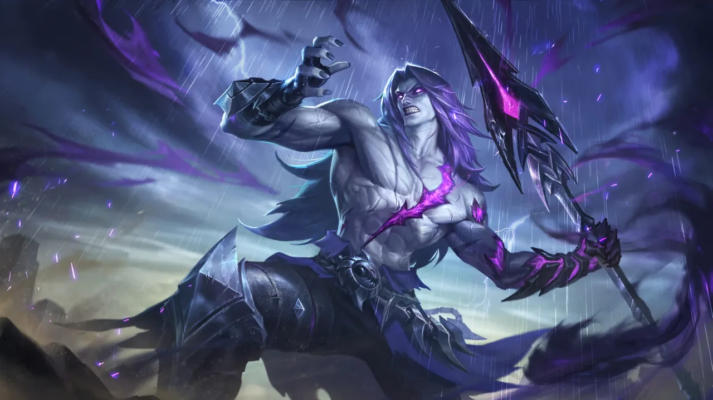
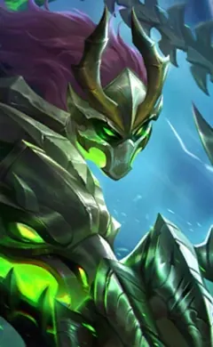

[Tier list](https://boostmlbb.ru/en/heroes/)[Items](https://boostmlbb.ru/en/items/)[Skins](https://boostmlbb.ru/en/skins/)[News & guides](https://boostmlbb.ru/en/news/)

[Skins](https://boostmlbb.ru/en/skins/)/Moskov

# Moskov skins

Skins

10

In the shop

4

Latest

[Infernal Wrymlord](https://boostmlbb.ru/en/skins/moskov/infernal-wrymlord.html)2024

[Hero profile→](https://boostmlbb.ru/en/heroes/moskov.html)

## All skins

AllGrandExquisiteDeluxeExceptionalCommon

[Infernal WrymlordGrand · 2024](https://boostmlbb.ru/en/skins/moskov/infernal-wrymlord.html)[Doom IncarnateGrand · 2023](https://boostmlbb.ru/en/skins/moskov/doom-incarnate.html)[Violet SpearExceptional · 2023](https://boostmlbb.ru/en/skins/moskov/violet-spear.html)[Twilight DragonExquisite · 2019](https://boostmlbb.ru/en/skins/moskov/twilight-dragon.html)[Decapi­tatorCommon · 2018](https://boostmlbb.ru/en/skins/moskov/decapitator.html)[Javelin ChampionExceptional · 2018](https://boostmlbb.ru/en/skins/moskov/javelin-champion.html)[YashaCommon · 2018](https://boostmlbb.ru/en/skins/moskov/yasha.html)[Blood SpearDeluxe · 2017](https://boostmlbb.ru/en/skins/moskov/blood-spear.html)[Snake Eye CommanderExceptional · 2017](https://boostmlbb.ru/en/skins/moskov/snake-eye-commander.html)[Spear of Bone DragonCommon · 2017](https://boostmlbb.ru/en/skins/moskov/spear-of-bone-dragon.html)

**Rank up on Moskov**The calculator shows the price

[Calculate price](https://boostmlbb.ru/en/order.html?type=hero)

## Frequently asked questions

How many skins does Moskov have?

10 skins, the default look not counted. The newest is Infernal Wrymlord (6 April 2024).

Which Moskov skins can you buy now?

Decapitator (599 diamonds), Javelin Champion (749 diamonds), Blood Spear (899 diamonds), Spear of Bone Dragon (269 diamonds). The other skins were limited and come back only in events.

What is the rarest Moskov skin?

Infernal Wrymlord, Grand class, ALLSTAR 2024 series. Esports skin of ALLSTAR 2024: it was released in the tournament event. Limited skins come back in event draws from time to time.
