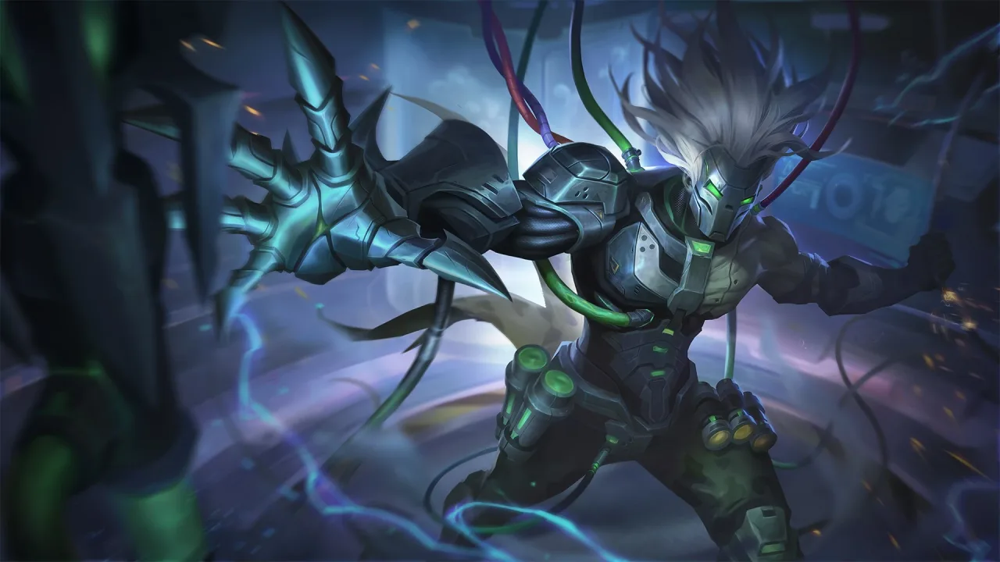

[Moskov skins](https://boostmlbb.ru/en/skins/moskov.html)

[Skins](https://boostmlbb.ru/en/skins/)/[Moskov](https://boostmlbb.ru/en/skins/moskov.html)/Decapitator

[Moskov skin](https://boostmlbb.ru/en/skins/moskov.html)

# Decapitator

CommonEliteIn the shop

How to get

Sold in the skin shop for 599 diamonds.

Price

599 diamonds

Released

2018

## What the skin changes

-   New look
-   Recoloured effects
-   Showcase animation
-   Attribute bonus

## All Moskov skins [10](https://boostmlbb.ru/en/skins/moskov.html)

[Infernal WrymlordGrand · 2024](https://boostmlbb.ru/en/skins/moskov/infernal-wrymlord.html)[Doom IncarnateGrand · 2023](https://boostmlbb.ru/en/skins/moskov/doom-incarnate.html)[Violet SpearExceptional · 2023](https://boostmlbb.ru/en/skins/moskov/violet-spear.html)[Twilight DragonExquisite · 2019](https://boostmlbb.ru/en/skins/moskov/twilight-dragon.html)[Decapi­tatorCommon · 2018](https://boostmlbb.ru/en/skins/moskov/decapitator.html)[Javelin ChampionExceptional · 2018](https://boostmlbb.ru/en/skins/moskov/javelin-champion.html)[YashaCommon · 2018](https://boostmlbb.ru/en/skins/moskov/yasha.html)[Blood SpearDeluxe · 2017](https://boostmlbb.ru/en/skins/moskov/blood-spear.html)[Snake Eye CommanderExceptional · 2017](https://boostmlbb.ru/en/skins/moskov/snake-eye-commander.html)[Spear of Bone DragonCommon · 2017](https://boostmlbb.ru/en/skins/moskov/spear-of-bone-dragon.html)

## Elite series

[Golden OsmanthusChang'e · 2026](https://boostmlbb.ru/en/skins/change/golden-osmanthus.html)[Warlord KingMartis · 2025](https://boostmlbb.ru/en/skins/martis/warlord-king.html)[High Seas CadetKimmy · 2024](https://boostmlbb.ru/en/skins/kimmy/high-seas-cadet.html)[Verdant LancerSilvanna · 2024](https://boostmlbb.ru/en/skins/silvanna/verdant-lancer.html)[Bloodhoof MarauderHylos · 2024](https://boostmlbb.ru/en/skins/hylos/bloodhoof-marauder.html)[Elegant ButterflyGuinevere · 2024](https://boostmlbb.ru/en/skins/guinevere/elegant-butterfly.html)[Marques of BladesLancelot · 2024](https://boostmlbb.ru/en/skins/lancelot/marques-of-blades.html)[Badlands HiatusChip · 2024](https://boostmlbb.ru/en/skins/chip/badlands-hiatus.html)

**How much is a rank boost on Moskov?**Choose your current and target ranks to see the price here.

[Calculate price](https://boostmlbb.ru/en/order.html?type=hero)

## Frequently asked questions

How to get the Decapitator skin for Moskov?

Sold in the skin shop for 599 diamonds.

When was Decapitator released?

2018.

What class is Decapitator?

Common, Elite series.
