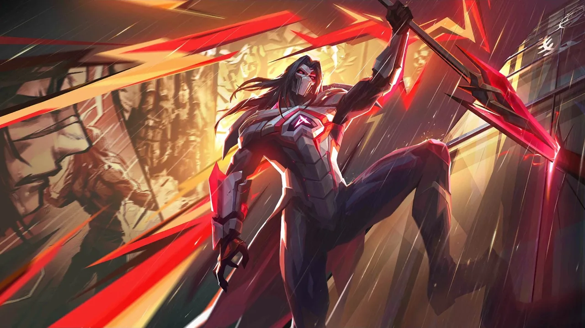
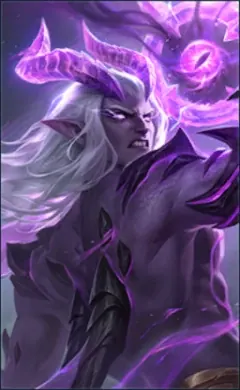

[Moskov skins](https://boostmlbb.ru/en/skins/moskov.html)

[Skins](https://boostmlbb.ru/en/skins/)/[Moskov](https://boostmlbb.ru/en/skins/moskov.html)/Doom Incarnate

[Moskov skin](https://boostmlbb.ru/en/skins/moskov.html)

# Doom Incarnate

GrandABYSSLimited

How to get

Released in the ABYSS event. Limited skins come back in event draws from time to time.

Released

7 October 2023

## What the skin changes

-   New look
-   New skill effects
-   Skill sounds
-   Voice-over
-   Showcase animation
-   Showcase scene
-   Attribute bonus

## All Moskov skins [10](https://boostmlbb.ru/en/skins/moskov.html)

[Infernal WrymlordGrand · 2024](https://boostmlbb.ru/en/skins/moskov/infernal-wrymlord.html)[Doom IncarnateGrand · 2023](https://boostmlbb.ru/en/skins/moskov/doom-incarnate.html)[Violet SpearExceptional · 2023](https://boostmlbb.ru/en/skins/moskov/violet-spear.html)[Twilight DragonExquisite · 2019](https://boostmlbb.ru/en/skins/moskov/twilight-dragon.html)[Decapi­tatorCommon · 2018](https://boostmlbb.ru/en/skins/moskov/decapitator.html)[Javelin ChampionExceptional · 2018](https://boostmlbb.ru/en/skins/moskov/javelin-champion.html)[YashaCommon · 2018](https://boostmlbb.ru/en/skins/moskov/yasha.html)[Blood SpearDeluxe · 2017](https://boostmlbb.ru/en/skins/moskov/blood-spear.html)[Snake Eye CommanderExceptional · 2017](https://boostmlbb.ru/en/skins/moskov/snake-eye-commander.html)[Spear of Bone DragonCommon · 2017](https://boostmlbb.ru/en/skins/moskov/spear-of-bone-dragon.html)

## ABYSS series

[General VoidAlpha · 2023](https://boostmlbb.ru/en/skins/alpha/general-void.html)[Shadow KnightLeomord · 2023](https://boostmlbb.ru/en/skins/leomord/shadow-knight.html)[Lady VengeanceSelena · 2021](https://boostmlbb.ru/en/skins/selena/lady-vengeance.html)

**How much is a rank boost on Moskov?**Choose your current and target ranks to see the price here.

[Calculate price](https://boostmlbb.ru/en/order.html?type=hero)

## Frequently asked questions

How to get the Doom Incarnate skin for Moskov?

Released in the ABYSS event. Limited skins come back in event draws from time to time.

When was Doom Incarnate released?

7 October 2023.

What class is Doom Incarnate?

Grand, ABYSS series.
