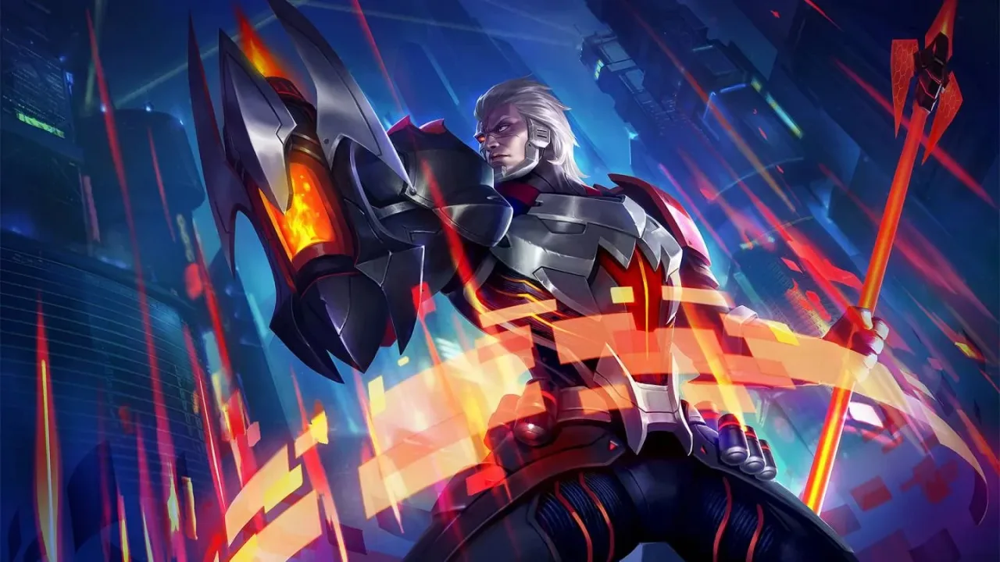

[Moskov skins](https://boostmlbb.ru/en/skins/moskov.html)

[Skins](https://boostmlbb.ru/en/skins/)/[Moskov](https://boostmlbb.ru/en/skins/moskov.html)/Snake Eye Commander

[Moskov skin](https://boostmlbb.ru/en/skins/moskov.html)

# Snake Eye Commander

ExceptionalStarLightLimited

How to get

StarLight reward for May 2017.

Released

1 May 2017

## What the skin changes

-   New look
-   New skill effects
-   Showcase animation
-   Attribute bonus

## All Moskov skins [10](https://boostmlbb.ru/en/skins/moskov.html)

[Infernal WrymlordGrand · 2024](https://boostmlbb.ru/en/skins/moskov/infernal-wrymlord.html)[Doom IncarnateGrand · 2023](https://boostmlbb.ru/en/skins/moskov/doom-incarnate.html)[Violet SpearExceptional · 2023](https://boostmlbb.ru/en/skins/moskov/violet-spear.html)[Twilight DragonExquisite · 2019](https://boostmlbb.ru/en/skins/moskov/twilight-dragon.html)[Decapi­tatorCommon · 2018](https://boostmlbb.ru/en/skins/moskov/decapitator.html)[Javelin ChampionExceptional · 2018](https://boostmlbb.ru/en/skins/moskov/javelin-champion.html)[YashaCommon · 2018](https://boostmlbb.ru/en/skins/moskov/yasha.html)[Blood SpearDeluxe · 2017](https://boostmlbb.ru/en/skins/moskov/blood-spear.html)[Snake Eye CommanderExceptional · 2017](https://boostmlbb.ru/en/skins/moskov/snake-eye-commander.html)[Spear of Bone DragonCommon · 2017](https://boostmlbb.ru/en/skins/moskov/spear-of-bone-dragon.html)

## StarLight series

[Tideborn SailorKalea · 2026](https://boostmlbb.ru/en/skins/kalea/tideborn-sailor.html)[Kitsune's ShadowHayabusa · 2026](https://boostmlbb.ru/en/skins/hayabusa/kitsune-s-shadow.html)[Fangs of SlaughterHanzo · 2026](https://boostmlbb.ru/en/skins/hanzo/fangs-of-slaughter.html)[Smoul­dering FortressBelerick · 2026](https://boostmlbb.ru/en/skins/belerick/smouldering-fortress.html)[Magitech WraithObsidia · 2026](https://boostmlbb.ru/en/skins/obsidia/magitech-wraith.html)[Elysian LuminanceZetian · 2026](https://boostmlbb.ru/en/skins/zetian/elysian-luminance.html)[Guardian BattalionHilda · 2026](https://boostmlbb.ru/en/skins/hilda/guardian-battalion.html)[Dreaming KoiHarley · 2026](https://boostmlbb.ru/en/skins/harley/dreaming-koi.html)

**How much is a rank boost on Moskov?**Choose your current and target ranks to see the price here.

[Calculate price](https://boostmlbb.ru/en/order.html?type=hero)

## Frequently asked questions

How to get the Snake Eye Commander skin for Moskov?

StarLight reward for May 2017.

When was Snake Eye Commander released?

1 May 2017.

What class is Snake Eye Commander?

Exceptional, StarLight series.
