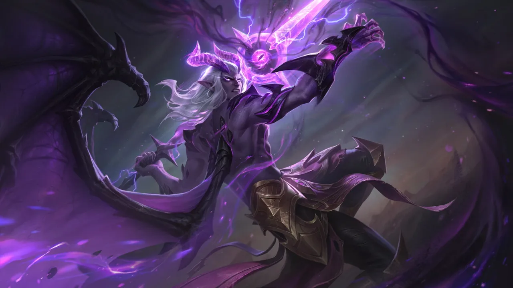
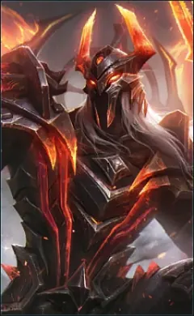

[Tier list](https://boostmlbb.ru/en/heroes/)[Items](https://boostmlbb.ru/en/items/)[Skins](https://boostmlbb.ru/en/skins/)[News & guides](https://boostmlbb.ru/en/news/)

[Skins](https://boostmlbb.ru/en/skins/)/[Moskov](https://boostmlbb.ru/en/skins/moskov.html)/Twilight Dragon

[Moskov skin](https://boostmlbb.ru/en/skins/moskov.html)

# Twilight Dragon

ExquisiteLuckyboxLimited

How to get

Came out of Lucky Boxes in events. Limited skins come back in event draws from time to time.

Released

January 2019

## What the skin changes

-   New look
-   New skill effects
-   Voice-over
-   Showcase animation
-   Showcase scene
-   Attribute bonus

## All Moskov skins [10](https://boostmlbb.ru/en/skins/moskov.html)

[Infernal WrymlordGrand · 2024](https://boostmlbb.ru/en/skins/moskov/infernal-wrymlord.html)[Doom IncarnateGrand · 2023](https://boostmlbb.ru/en/skins/moskov/doom-incarnate.html)[Violet SpearExceptional · 2023](https://boostmlbb.ru/en/skins/moskov/violet-spear.html)[Twilight DragonExquisite · 2019](https://boostmlbb.ru/en/skins/moskov/twilight-dragon.html)[Decapi­tatorCommon · 2018](https://boostmlbb.ru/en/skins/moskov/decapitator.html)[Javelin ChampionExceptional · 2018](https://boostmlbb.ru/en/skins/moskov/javelin-champion.html)[YashaCommon · 2018](https://boostmlbb.ru/en/skins/moskov/yasha.html)[Blood SpearDeluxe · 2017](https://boostmlbb.ru/en/skins/moskov/blood-spear.html)[Snake Eye CommanderExceptional · 2017](https://boostmlbb.ru/en/skins/moskov/snake-eye-commander.html)[Spear of Bone DragonCommon · 2017](https://boostmlbb.ru/en/skins/moskov/spear-of-bone-dragon.html)

## Luckybox series

[Lady CraneGuinevere · 2025](https://boostmlbb.ru/en/skins/guinevere/lady-crane.html)[Butterfly SeraphimLunox · 2025](https://boostmlbb.ru/en/skins/lunox/butterfly-seraphim.html)[Mecha DragonClaude · 2025](https://boostmlbb.ru/en/skins/claude/mecha-dragon.html)[Lunar MagicChang'e · 2020](https://boostmlbb.ru/en/skins/change/lunar-magic.html)[Thunder FlashSelena · 2020](https://boostmlbb.ru/en/skins/selena/thunder-flash.html)[RaksheshaHanabi · 2020](https://boostmlbb.ru/en/skins/hanabi/rakshesha.html)[Video-Game DominatorUranus · 2020](https://boostmlbb.ru/en/skins/uranus/video-game-dominator.html)[God of WarMartis · 2020](https://boostmlbb.ru/en/skins/martis/god-of-war.html)

**Rank up on Moskov**The calculator shows the price

[Calculate price](https://boostmlbb.ru/en/order.html?type=hero)

## Frequently asked questions

How to get the Twilight Dragon skin for Moskov?

Came out of Lucky Boxes in events. Limited skins come back in event draws from time to time.

When was Twilight Dragon released?

January 2019.

What class is Twilight Dragon?

Exquisite, Luckybox series.
