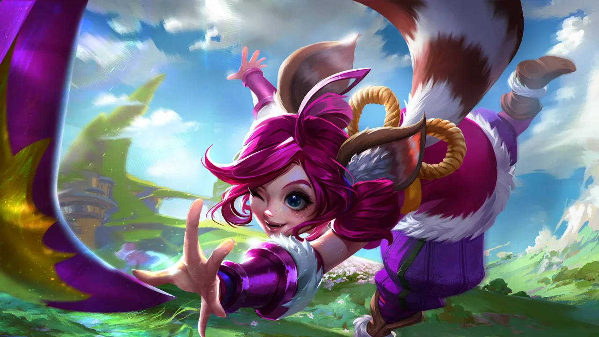
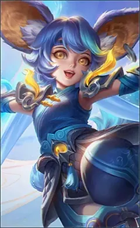

[All skins](https://boostmlbb.ru/en/skins/)

[Skins](https://boostmlbb.ru/en/skins/)/Nana

# Nana skins

Skins

9

In the shop

4

Latest

[Mistbender Nana](https://boostmlbb.ru/en/skins/nana/mistbender-nana.html)2023

[Hero profile→](https://boostmlbb.ru/en/heroes/nana.html)

## All skins

AllGrandExquisiteDeluxeExceptionalCommon

[Mistbender NanaGrand · 2023](https://boostmlbb.ru/en/skins/nana/mistbender-nana.html)[Cyclone ClashExceptional · 2022](https://boostmlbb.ru/en/skins/nana/cyclone-clash.html)[Aqua PuraExquisite · 2021](https://boostmlbb.ru/en/skins/nana/aqua-pura.html)[Mecha BabyDeluxe · 2020](https://boostmlbb.ru/en/skins/nana/mecha-baby.html)[SundressExceptional · 2019](https://boostmlbb.ru/en/skins/nana/sundress.html)[Wind FairyExceptional · 2018](https://boostmlbb.ru/en/skins/nana/wind-fairy.html)[Slumber PartyCommon · 2017](https://boostmlbb.ru/en/skins/nana/slumber-party.html)[Graveyard PartyCommon · 2016](https://boostmlbb.ru/en/skins/nana/graveyard-party.html)[Clockwork MaidCommon · 2016](https://boostmlbb.ru/en/skins/nana/clockwork-maid.html)

**How much is a rank boost on Nana?**Choose your current and target ranks to see the price here.

[Calculate price](https://boostmlbb.ru/en/order.html?type=hero)

## Frequently asked questions

How many skins does Nana have?

9 skins, the default look not counted. The newest is Mistbender Nana (9 December 2023).

Which Nana skins can you buy now?

Mecha Baby (899 diamonds), Sundress (749 diamonds), Slumber Party (599 diamonds), Clockwork Maid (399 diamonds). The other skins were limited and come back only in events.

What is the rarest Nana skin?

Mistbender Nana, Grand class, Mistbenders series. Released in the Mistbenders event. Limited skins come back in event draws from time to time.
