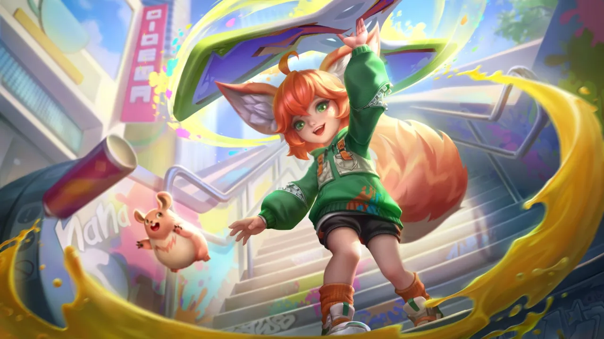
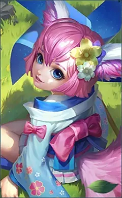

[Nana skins](https://boostmlbb.ru/en/skins/nana.html)

[Skins](https://boostmlbb.ru/en/skins/)/[Nana](https://boostmlbb.ru/en/skins/nana.html)/Cyclone Clash

[Nana skin](https://boostmlbb.ru/en/skins/nana.html)

# Cyclone Clash

ExceptionalStarLightLimited

How to get

StarLight reward for July 2022.

Released

1 July 2022

## What the skin changes

-   New look
-   New skill effects
-   Showcase animation
-   Showcase scene
-   Attribute bonus

## All Nana skins [9](https://boostmlbb.ru/en/skins/nana.html)

[Mistbender NanaGrand · 2023](https://boostmlbb.ru/en/skins/nana/mistbender-nana.html)[Cyclone ClashExceptional · 2022](https://boostmlbb.ru/en/skins/nana/cyclone-clash.html)[Aqua PuraExquisite · 2021](https://boostmlbb.ru/en/skins/nana/aqua-pura.html)[Mecha BabyDeluxe · 2020](https://boostmlbb.ru/en/skins/nana/mecha-baby.html)[SundressExceptional · 2019](https://boostmlbb.ru/en/skins/nana/sundress.html)[Wind FairyExceptional · 2018](https://boostmlbb.ru/en/skins/nana/wind-fairy.html)[Slumber PartyCommon · 2017](https://boostmlbb.ru/en/skins/nana/slumber-party.html)[Graveyard PartyCommon · 2016](https://boostmlbb.ru/en/skins/nana/graveyard-party.html)[Clockwork MaidCommon · 2016](https://boostmlbb.ru/en/skins/nana/clockwork-maid.html)

## StarLight series

[Tideborn SailorKalea · 2026](https://boostmlbb.ru/en/skins/kalea/tideborn-sailor.html)[Kitsune's ShadowHayabusa · 2026](https://boostmlbb.ru/en/skins/hayabusa/kitsune-s-shadow.html)[Fangs of SlaughterHanzo · 2026](https://boostmlbb.ru/en/skins/hanzo/fangs-of-slaughter.html)[Smoul­dering FortressBelerick · 2026](https://boostmlbb.ru/en/skins/belerick/smouldering-fortress.html)[Magitech WraithObsidia · 2026](https://boostmlbb.ru/en/skins/obsidia/magitech-wraith.html)[Elysian LuminanceZetian · 2026](https://boostmlbb.ru/en/skins/zetian/elysian-luminance.html)[Guardian BattalionHilda · 2026](https://boostmlbb.ru/en/skins/hilda/guardian-battalion.html)[Dreaming KoiHarley · 2026](https://boostmlbb.ru/en/skins/harley/dreaming-koi.html)

**How much is a rank boost on Nana?**Choose your current and target ranks to see the price here.

[Calculate price](https://boostmlbb.ru/en/order.html?type=hero)

## Frequently asked questions

How to get the Cyclone Clash skin for Nana?

StarLight reward for July 2022.

When was Cyclone Clash released?

1 July 2022.

What class is Cyclone Clash?

Exceptional, StarLight series.
