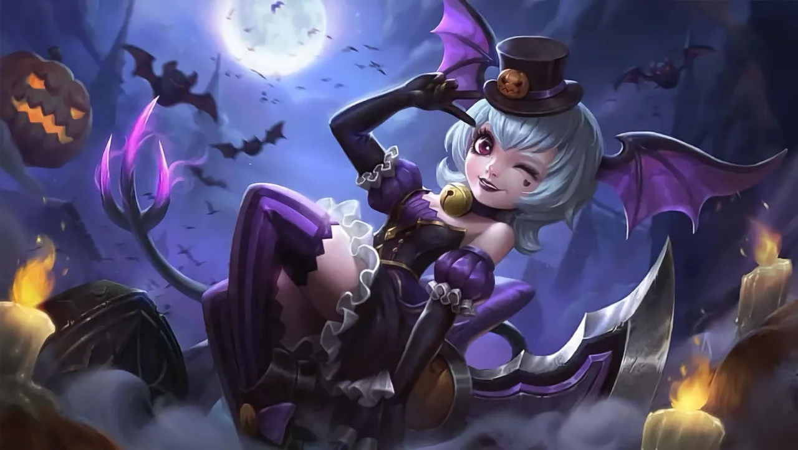
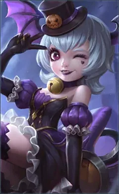

[Nana skins](https://boostmlbb.ru/en/skins/nana.html)

[Skins](https://boostmlbb.ru/en/skins/)/[Nana](https://boostmlbb.ru/en/skins/nana.html)/Graveyard Party

[Nana skin](https://boostmlbb.ru/en/skins/nana.html)

# Graveyard Party

CommonSeason 1Limited

How to get

Ranked Season 1 reward.

Released

2016

## What the skin changes

-   New look
-   Attribute bonus

## All Nana skins [9](https://boostmlbb.ru/en/skins/nana.html)

[Mistbender NanaGrand · 2023](https://boostmlbb.ru/en/skins/nana/mistbender-nana.html)[Cyclone ClashExceptional · 2022](https://boostmlbb.ru/en/skins/nana/cyclone-clash.html)[Aqua PuraExquisite · 2021](https://boostmlbb.ru/en/skins/nana/aqua-pura.html)[Mecha BabyDeluxe · 2020](https://boostmlbb.ru/en/skins/nana/mecha-baby.html)[SundressExceptional · 2019](https://boostmlbb.ru/en/skins/nana/sundress.html)[Wind FairyExceptional · 2018](https://boostmlbb.ru/en/skins/nana/wind-fairy.html)[Slumber PartyCommon · 2017](https://boostmlbb.ru/en/skins/nana/slumber-party.html)[Graveyard PartyCommon · 2016](https://boostmlbb.ru/en/skins/nana/graveyard-party.html)[Clockwork MaidCommon · 2016](https://boostmlbb.ru/en/skins/nana/clockwork-maid.html)

**How much is a rank boost on Nana?**Choose your current and target ranks to see the price here.

[Calculate price](https://boostmlbb.ru/en/order.html?type=hero)

## Frequently asked questions

How to get the Graveyard Party skin for Nana?

Ranked Season 1 reward.

When was Graveyard Party released?

2016.

What class is Graveyard Party?

Common, Season 1 series.
