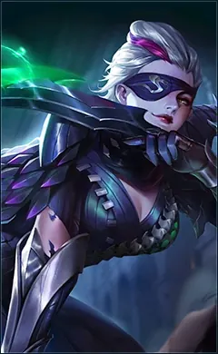

[Tier list](https://boostmlbb.ru/en/heroes/)[Items](https://boostmlbb.ru/en/items/)[Skins](https://boostmlbb.ru/en/skins/)[News & guides](https://boostmlbb.ru/en/news/)

[Skins](https://boostmlbb.ru/en/skins/)/Natalia

# Natalia skins

Skins

8

In the shop

4

Latest

[Soul Huntress](https://boostmlbb.ru/en/skins/natalia/soul-huntress.html)2025

[Hero profile→](https://boostmlbb.ru/en/heroes/natalia.html)

## All skins

AllExquisiteDeluxeExceptionalCommon

[Soul HuntressDeluxe · 2025](https://boostmlbb.ru/en/skins/natalia/soul-huntress.html)[Warrioress ParagonExquisite · 2024](https://boostmlbb.ru/en/skins/natalia/warrioress-paragon.html)[Cyber SpectreExceptional · 2020](https://boostmlbb.ru/en/skins/natalia/cyber-spectre.html)[Grim StranglerExceptional · 2020](https://boostmlbb.ru/en/skins/natalia/grim-strangler.html)[Midnight RavenExceptional · 2018](https://boostmlbb.ru/en/skins/natalia/midnight-raven.html)[Deadly MambaCommon · 2018](https://boostmlbb.ru/en/skins/natalia/deadly-mamba.html)[Phantom DancerExceptional · 2017](https://boostmlbb.ru/en/skins/natalia/phantom-dancer.html)[Glass BladeCommon · 2016](https://boostmlbb.ru/en/skins/natalia/glass-blade.html)

**Rank up on Natalia**The calculator shows the price

[Calculate price](https://boostmlbb.ru/en/order.html?type=hero)

## Frequently asked questions

How many skins does Natalia have?

8 skins, the default look not counted. The newest is Soul Huntress (17 August 2025).

Which Natalia skins can you buy now?

Soul Huntress (899 diamonds), Cyber Spectre (749 diamonds), Midnight Raven (749 diamonds), Glass Blade (269 diamonds). The other skins were limited and come back only in events.

What is the rarest Natalia skin?

Warrioress Paragon, Exquisite class, Collector series. The top prize of a Collector event draw, paid with diamonds. Limited skins come back in event draws from time to time.
