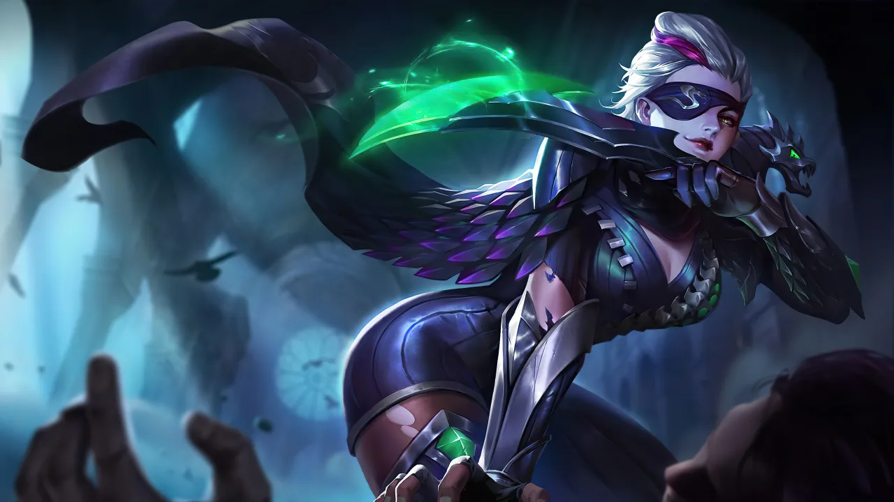

[Natalia skins](https://boostmlbb.ru/en/skins/natalia.html)

[Skins](https://boostmlbb.ru/en/skins/)/[Natalia](https://boostmlbb.ru/en/skins/natalia.html)/Deadly Mamba

[Natalia skin](https://boostmlbb.ru/en/skins/natalia.html)

# Deadly Mamba

CommonEliteLimited

How to get

Released in the skin shop during an event. Limited skins come back in event draws from time to time.

Released

2018

## What the skin changes

-   New look
-   Recoloured effects
-   Showcase animation
-   Attribute bonus

## Painted versions

The same skin in other colours. A painted version needs the skin itself.

-   **Rogue Mamba**Celestial Chest reward.

## All Natalia skins [8](https://boostmlbb.ru/en/skins/natalia.html)

[Soul HuntressDeluxe · 2025](https://boostmlbb.ru/en/skins/natalia/soul-huntress.html)[Warrioress ParagonExquisite · 2024](https://boostmlbb.ru/en/skins/natalia/warrioress-paragon.html)[Cyber SpectreExceptional · 2020](https://boostmlbb.ru/en/skins/natalia/cyber-spectre.html)[Grim StranglerExceptional · 2020](https://boostmlbb.ru/en/skins/natalia/grim-strangler.html)[Midnight RavenExceptional · 2018](https://boostmlbb.ru/en/skins/natalia/midnight-raven.html)[Deadly MambaCommon · 2018](https://boostmlbb.ru/en/skins/natalia/deadly-mamba.html)[Phantom DancerExceptional · 2017](https://boostmlbb.ru/en/skins/natalia/phantom-dancer.html)[Glass BladeCommon · 2016](https://boostmlbb.ru/en/skins/natalia/glass-blade.html)

## Elite series

[Golden OsmanthusChang'e · 2026](https://boostmlbb.ru/en/skins/change/golden-osmanthus.html)[Warlord KingMartis · 2025](https://boostmlbb.ru/en/skins/martis/warlord-king.html)[High Seas CadetKimmy · 2024](https://boostmlbb.ru/en/skins/kimmy/high-seas-cadet.html)[Verdant LancerSilvanna · 2024](https://boostmlbb.ru/en/skins/silvanna/verdant-lancer.html)[Bloodhoof MarauderHylos · 2024](https://boostmlbb.ru/en/skins/hylos/bloodhoof-marauder.html)[Elegant ButterflyGuinevere · 2024](https://boostmlbb.ru/en/skins/guinevere/elegant-butterfly.html)[Marques of BladesLancelot · 2024](https://boostmlbb.ru/en/skins/lancelot/marques-of-blades.html)[Badlands HiatusChip · 2024](https://boostmlbb.ru/en/skins/chip/badlands-hiatus.html)

**How much is a rank boost on Natalia?**Choose your current and target ranks to see the price here.

[Calculate price](https://boostmlbb.ru/en/order.html?type=hero)

## Frequently asked questions

How to get the Deadly Mamba skin for Natalia?

Released in the skin shop during an event. Limited skins come back in event draws from time to time.

When was Deadly Mamba released?

2018.

What class is Deadly Mamba?

Common, Elite series.
