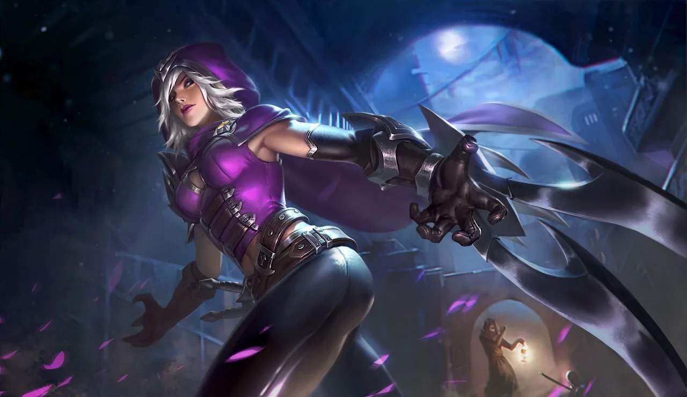

[Natalia skins](https://boostmlbb.ru/en/skins/natalia.html)

[Skins](https://boostmlbb.ru/en/skins/)/[Natalia](https://boostmlbb.ru/en/skins/natalia.html)/Glass Blade

[Natalia skin](https://boostmlbb.ru/en/skins/natalia.html)

# Glass Blade

CommonIn the shop

How to get

Sold in the skin shop for 269 diamonds.

Price

269 diamonds

Released

2016

## What the skin changes

-   Attribute bonus

## All Natalia skins [8](https://boostmlbb.ru/en/skins/natalia.html)

[Soul HuntressDeluxe · 2025](https://boostmlbb.ru/en/skins/natalia/soul-huntress.html)[Warrioress ParagonExquisite · 2024](https://boostmlbb.ru/en/skins/natalia/warrioress-paragon.html)[Cyber SpectreExceptional · 2020](https://boostmlbb.ru/en/skins/natalia/cyber-spectre.html)[Grim StranglerExceptional · 2020](https://boostmlbb.ru/en/skins/natalia/grim-strangler.html)[Midnight RavenExceptional · 2018](https://boostmlbb.ru/en/skins/natalia/midnight-raven.html)[Deadly MambaCommon · 2018](https://boostmlbb.ru/en/skins/natalia/deadly-mamba.html)[Phantom DancerExceptional · 2017](https://boostmlbb.ru/en/skins/natalia/phantom-dancer.html)[Glass BladeCommon · 2016](https://boostmlbb.ru/en/skins/natalia/glass-blade.html)

**How much is a rank boost on Natalia?**Choose your current and target ranks to see the price here.

[Calculate price](https://boostmlbb.ru/en/order.html?type=hero)

## Frequently asked questions

How to get the Glass Blade skin for Natalia?

Sold in the skin shop for 269 diamonds.

When was Glass Blade released?

2016.

What class is Glass Blade?

Common.
