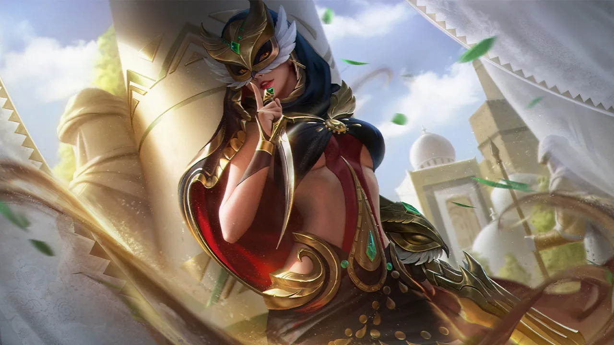

[Natalia skins](https://boostmlbb.ru/en/skins/natalia.html)

[Skins](https://boostmlbb.ru/en/skins/)/[Natalia](https://boostmlbb.ru/en/skins/natalia.html)/Phantom Dancer

[Natalia skin](https://boostmlbb.ru/en/skins/natalia.html)

# Phantom Dancer

ExceptionalStarLightLimited

How to get

StarLight reward for April 2017.

Released

1 April 2017

## What the skin changes

-   New look
-   New skill effects
-   Showcase animation
-   Attribute bonus

## All Natalia skins [8](https://boostmlbb.ru/en/skins/natalia.html)

[Soul HuntressDeluxe · 2025](https://boostmlbb.ru/en/skins/natalia/soul-huntress.html)[Warrioress ParagonExquisite · 2024](https://boostmlbb.ru/en/skins/natalia/warrioress-paragon.html)[Cyber SpectreExceptional · 2020](https://boostmlbb.ru/en/skins/natalia/cyber-spectre.html)[Grim StranglerExceptional · 2020](https://boostmlbb.ru/en/skins/natalia/grim-strangler.html)[Midnight RavenExceptional · 2018](https://boostmlbb.ru/en/skins/natalia/midnight-raven.html)[Deadly MambaCommon · 2018](https://boostmlbb.ru/en/skins/natalia/deadly-mamba.html)[Phantom DancerExceptional · 2017](https://boostmlbb.ru/en/skins/natalia/phantom-dancer.html)[Glass BladeCommon · 2016](https://boostmlbb.ru/en/skins/natalia/glass-blade.html)

## StarLight series

[Tideborn SailorKalea · 2026](https://boostmlbb.ru/en/skins/kalea/tideborn-sailor.html)[Kitsune's ShadowHayabusa · 2026](https://boostmlbb.ru/en/skins/hayabusa/kitsune-s-shadow.html)[Fangs of SlaughterHanzo · 2026](https://boostmlbb.ru/en/skins/hanzo/fangs-of-slaughter.html)[Smoul­dering FortressBelerick · 2026](https://boostmlbb.ru/en/skins/belerick/smouldering-fortress.html)[Magitech WraithObsidia · 2026](https://boostmlbb.ru/en/skins/obsidia/magitech-wraith.html)[Elysian LuminanceZetian · 2026](https://boostmlbb.ru/en/skins/zetian/elysian-luminance.html)[Guardian BattalionHilda · 2026](https://boostmlbb.ru/en/skins/hilda/guardian-battalion.html)[Dreaming KoiHarley · 2026](https://boostmlbb.ru/en/skins/harley/dreaming-koi.html)

**How much is a rank boost on Natalia?**Choose your current and target ranks to see the price here.

[Calculate price](https://boostmlbb.ru/en/order.html?type=hero)

## Frequently asked questions

How to get the Phantom Dancer skin for Natalia?

StarLight reward for April 2017.

When was Phantom Dancer released?

1 April 2017.

What class is Phantom Dancer?

Exceptional, StarLight series.
