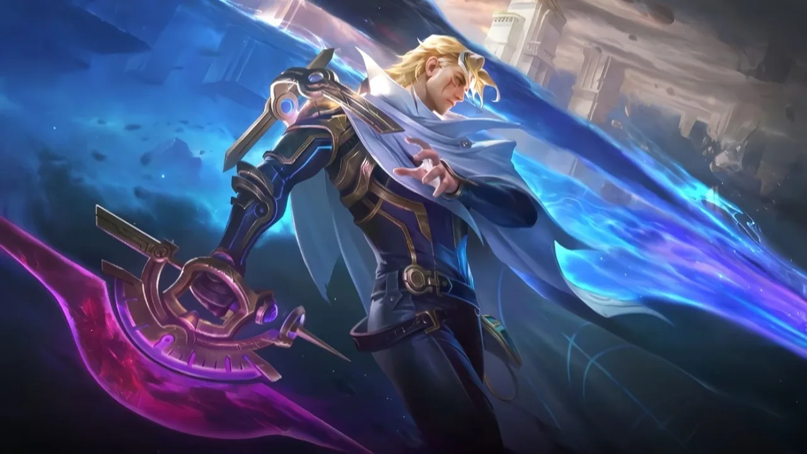

[Tier list](https://boostmlbb.ru/en/heroes/)[Items](https://boostmlbb.ru/en/items/)[Skins](https://boostmlbb.ru/en/skins/)[News & guides](https://boostmlbb.ru/en/news/)

[Skins](https://boostmlbb.ru/en/skins/)/Nolan

# Nolan skins

Skins

3

In the shop

1

Latest

[The Navigator](https://boostmlbb.ru/en/skins/nolan/the-navigator.html)2024

[Hero profile→](https://boostmlbb.ru/en/heroes/nolan.html)

## All skins

[The NavigatorGrand · 2024](https://boostmlbb.ru/en/skins/nolan/the-navigator.html)[Fashion MogulExceptional · 2024](https://boostmlbb.ru/en/skins/nolan/fashion-mogul.html)[VoidwalkerCommon · 2023](https://boostmlbb.ru/en/skins/nolan/voidwalker.html)

**Rank up on Nolan**The calculator shows the price

[Calculate price](https://boostmlbb.ru/en/order.html?type=hero)

## Frequently asked questions

How many skins does Nolan have?

3 skins, the default look not counted. The newest is The Navigator (November 2024).

Which Nolan skins can you buy now?

Voidwalker (269 diamonds). The other skins were limited and come back only in events.

What is the rarest Nolan skin?

The Navigator, Grand class, Double 11 series. Released in the skin shop during an event. Limited skins come back in event draws from time to time.
