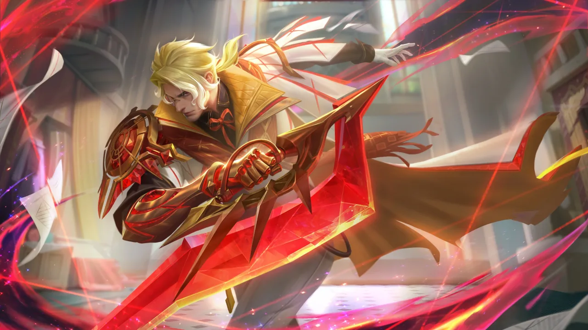

[Tier list](https://boostmlbb.ru/en/heroes/)[Items](https://boostmlbb.ru/en/items/)[Skins](https://boostmlbb.ru/en/skins/)[News & guides](https://boostmlbb.ru/en/news/)

[Skins](https://boostmlbb.ru/en/skins/)/[Nolan](https://boostmlbb.ru/en/skins/nolan.html)/Fashion Mogul

[Nolan skin](https://boostmlbb.ru/en/skins/nolan.html)

# Fashion Mogul

ExceptionalStarLightLimited

How to get

StarLight reward for May 2024.

Released

1 May 2024

## What the skin changes

-   New look
-   New skill effects
-   Showcase animation
-   Showcase scene
-   Attribute bonus

## All Nolan skins [3](https://boostmlbb.ru/en/skins/nolan.html)

[The NavigatorGrand · 2024](https://boostmlbb.ru/en/skins/nolan/the-navigator.html)[Fashion MogulExceptional · 2024](https://boostmlbb.ru/en/skins/nolan/fashion-mogul.html)[VoidwalkerCommon · 2023](https://boostmlbb.ru/en/skins/nolan/voidwalker.html)

## StarLight series

[Tideborn SailorKalea · 2026](https://boostmlbb.ru/en/skins/kalea/tideborn-sailor.html)[Kitsune's ShadowHayabusa · 2026](https://boostmlbb.ru/en/skins/hayabusa/kitsune-s-shadow.html)[Fangs of SlaughterHanzo · 2026](https://boostmlbb.ru/en/skins/hanzo/fangs-of-slaughter.html)[Smoul­dering FortressBelerick · 2026](https://boostmlbb.ru/en/skins/belerick/smouldering-fortress.html)[Magitech WraithObsidia · 2026](https://boostmlbb.ru/en/skins/obsidia/magitech-wraith.html)[Elysian LuminanceZetian · 2026](https://boostmlbb.ru/en/skins/zetian/elysian-luminance.html)[Guardian BattalionHilda · 2026](https://boostmlbb.ru/en/skins/hilda/guardian-battalion.html)[Dreaming KoiHarley · 2026](https://boostmlbb.ru/en/skins/harley/dreaming-koi.html)

**Rank up on Nolan**The calculator shows the price

[Calculate price](https://boostmlbb.ru/en/order.html?type=hero)

## Frequently asked questions

How to get the Fashion Mogul skin for Nolan?

StarLight reward for May 2024.

When was Fashion Mogul released?

1 May 2024.

What class is Fashion Mogul?

Exceptional, StarLight series.
