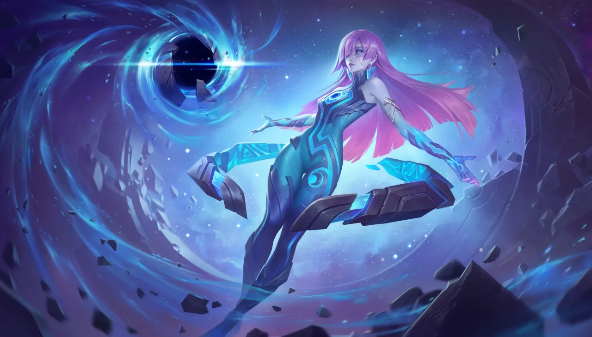

[Tier list](https://boostmlbb.ru/en/heroes/)[Items](https://boostmlbb.ru/en/items/)[Skins](https://boostmlbb.ru/en/skins/)[News & guides](https://boostmlbb.ru/en/news/)

[Skins](https://boostmlbb.ru/en/skins/)/Novaria

# Novaria skins

Skins

3

In the shop

1

Latest

[Dra­gonsworn](https://boostmlbb.ru/en/skins/novaria/dragonsworn.html)2025

[Hero profile→](https://boostmlbb.ru/en/heroes/novaria.html)

## All skins

[Dra­gonswornExquisite · 2025](https://boostmlbb.ru/en/skins/novaria/dragonsworn.html)[Sugar GlazeExceptional · 2024](https://boostmlbb.ru/en/skins/novaria/sugar-glaze.html)[Dark StarCommon · 2023](https://boostmlbb.ru/en/skins/novaria/dark-star.html)

**Rank up on Novaria**The calculator shows the price

[Calculate price](https://boostmlbb.ru/en/order.html?type=hero)

## Frequently asked questions

How many skins does Novaria have?

3 skins, the default look not counted. The newest is Dragonsworn (3 September 2025).

Which Novaria skins can you buy now?

Dark Star (269 diamonds). The other skins were limited and come back only in events.

What is the rarest Novaria skin?

Dragonsworn, Exquisite class, Collector series. The top prize of a Collector event draw, paid with diamonds. Limited skins come back in event draws from time to time.
