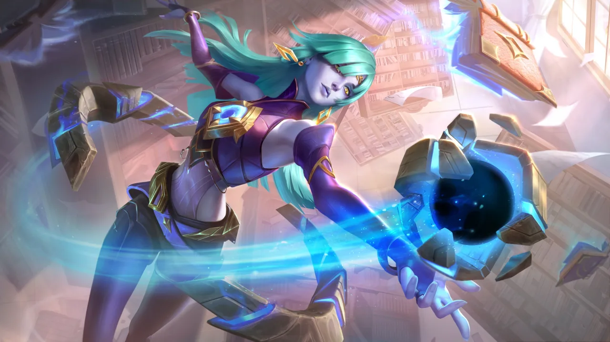

[Novaria skins](https://boostmlbb.ru/en/skins/novaria.html)

[Skins](https://boostmlbb.ru/en/skins/)/[Novaria](https://boostmlbb.ru/en/skins/novaria.html)/Dark Star

[Novaria skin](https://boostmlbb.ru/en/skins/novaria.html)

# Dark Star

CommonIn the shop

How to get

Sold in the skin shop for 269 diamonds.

Price

269 diamonds

Released

16 May 2023

## What the skin changes

-   Attribute bonus

## All Novaria skins [3](https://boostmlbb.ru/en/skins/novaria.html)

[Dra­gonswornExquisite · 2025](https://boostmlbb.ru/en/skins/novaria/dragonsworn.html)[Sugar GlazeExceptional · 2024](https://boostmlbb.ru/en/skins/novaria/sugar-glaze.html)[Dark StarCommon · 2023](https://boostmlbb.ru/en/skins/novaria/dark-star.html)

**How much is a rank boost on Novaria?**Choose your current and target ranks to see the price here.

[Calculate price](https://boostmlbb.ru/en/order.html?type=hero)

## Frequently asked questions

How to get the Dark Star skin for Novaria?

Sold in the skin shop for 269 diamonds.

When was Dark Star released?

16 May 2023.

What class is Dark Star?

Common.
