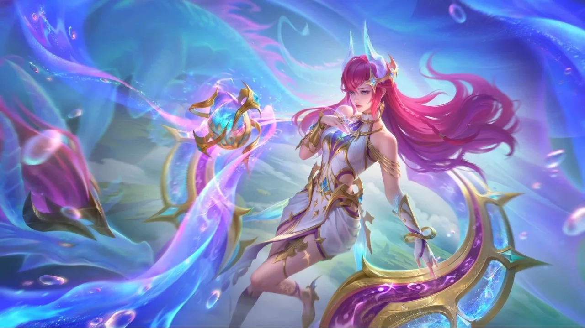

[Novaria skins](https://boostmlbb.ru/en/skins/novaria.html)

[Skins](https://boostmlbb.ru/en/skins/)/[Novaria](https://boostmlbb.ru/en/skins/novaria.html)/Dragonsworn

[Novaria skin](https://boostmlbb.ru/en/skins/novaria.html)

# Dragonsworn

ExquisiteCollectorLimited

How to get

The top prize of a Collector event draw, paid with diamonds. Limited skins come back in event draws from time to time.

Released

3 September 2025

## What the skin changes

-   New look
-   New skill effects
-   Skill sounds
-   Voice-over
-   Showcase animation
-   Showcase scene
-   Showcase music
-   Special actions
-   Attribute bonus

## All Novaria skins [3](https://boostmlbb.ru/en/skins/novaria.html)

[Dra­gonswornExquisite · 2025](https://boostmlbb.ru/en/skins/novaria/dragonsworn.html)[Sugar GlazeExceptional · 2024](https://boostmlbb.ru/en/skins/novaria/sugar-glaze.html)[Dark StarCommon · 2023](https://boostmlbb.ru/en/skins/novaria/dark-star.html)

## Collector series

[The PurifierBruno · 2026](https://boostmlbb.ru/en/skins/bruno/the-purifier.html)[Celestial RebelSun · 2026](https://boostmlbb.ru/en/skins/sun/celestial-rebel.html)[Kaiju of the DeepHelcurt · 2026](https://boostmlbb.ru/en/skins/helcurt/kaiju-of-the-deep.html)[Starbound SentryKimmy · 2026](https://boostmlbb.ru/en/skins/kimmy/starbound-sentry.html)[Dreaming MonarchAlice · 2026](https://boostmlbb.ru/en/skins/alice/dreaming-monarch.html)[Tremor of the DeepGrock · 2026](https://boostmlbb.ru/en/skins/grock/tremor-of-the-deep.html)[Celestial GeneralTigreal · 2026](https://boostmlbb.ru/en/skins/tigreal/celestial-general.html)[Sunborn MonarchXavier · 2026](https://boostmlbb.ru/en/skins/xavier/sunborn-monarch.html)

**How much is a rank boost on Novaria?**Choose your current and target ranks to see the price here.

[Calculate price](https://boostmlbb.ru/en/order.html?type=hero)

## Frequently asked questions

How to get the Dragonsworn skin for Novaria?

The top prize of a Collector event draw, paid with diamonds. Limited skins come back in event draws from time to time.

When was Dragonsworn released?

3 September 2025.

What class is Dragonsworn?

Exquisite, Collector series.
