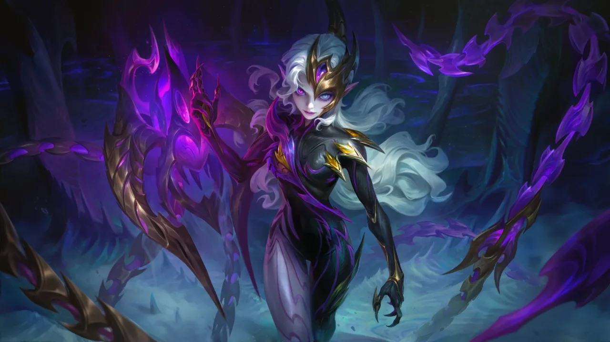

[All skins](https://boostmlbb.ru/en/skins/)

[Skins](https://boostmlbb.ru/en/skins/)/Obsidia

# Obsidia skins

Skins

3

In the shop

1

Latest

[Imperatrix Arashi](https://boostmlbb.ru/en/skins/obsidia/imperatrix-arashi.html)2026

[Hero profile→](https://boostmlbb.ru/en/heroes/obsidia.html)

## All skins

[Imperatrix ArashiGrand · 2026](https://boostmlbb.ru/en/skins/obsidia/imperatrix-arashi.html)[Magitech Wraith2026](https://boostmlbb.ru/en/skins/obsidia/magitech-wraith.html)[Undying RemnantsCommon · 2025](https://boostmlbb.ru/en/skins/obsidia/undying-remnants.html)

**How much is a rank boost on Obsidia?**Choose your current and target ranks to see the price here.

[Calculate price](https://boostmlbb.ru/en/order.html?type=hero)

## Frequently asked questions

How many skins does Obsidia have?

3 skins, the default look not counted. The newest is Imperatrix Arashi (9 October 2026).

Which Obsidia skins can you buy now?

Undying Remnants (269 diamonds). The other skins were limited and come back only in events.

What is the rarest Obsidia skin?

Imperatrix Arashi, Grand class, The Aspirants series. Released in the The Aspirants event. Limited skins come back in event draws from time to time.
