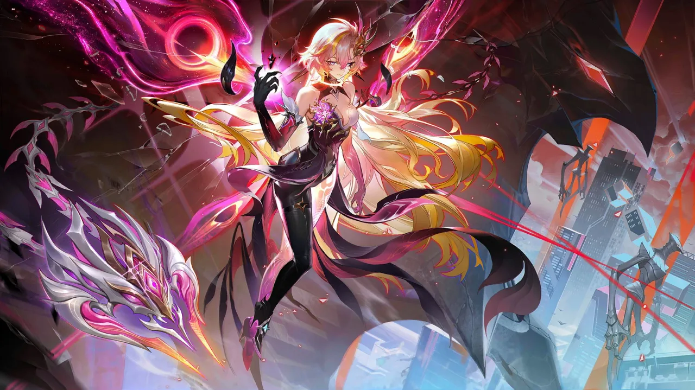

[Tier list](https://boostmlbb.ru/en/heroes/)[Items](https://boostmlbb.ru/en/items/)[Skins](https://boostmlbb.ru/en/skins/)[News & guides](https://boostmlbb.ru/en/news/)

[Skins](https://boostmlbb.ru/en/skins/)/[Obsidia](https://boostmlbb.ru/en/skins/obsidia.html)/Imperatrix Arashi

[Obsidia skin](https://boostmlbb.ru/en/skins/obsidia.html)

# Imperatrix Arashi

GrandThe AspirantsLimited

How to get

Released in the The Aspirants event. Limited skins come back in event draws from time to time.

Released

9 October 2026

## What the skin changes

-   New look
-   New skill effects
-   Skill sounds
-   Voice-over
-   Skill icons
-   Showcase animation
-   Showcase scene
-   Showcase music
-   Spawn animation
-   Special actions
-   Attribute bonus

## All Obsidia skins [3](https://boostmlbb.ru/en/skins/obsidia.html)

[Imperatrix ArashiGrand · 2026](https://boostmlbb.ru/en/skins/obsidia/imperatrix-arashi.html)[Magitech Wraith2026](https://boostmlbb.ru/en/skins/obsidia/magitech-wraith.html)[Undying RemnantsCommon · 2025](https://boostmlbb.ru/en/skins/obsidia/undying-remnants.html)

## The Aspirants series

[Silverbolt RaikoSelena · 2026](https://boostmlbb.ru/en/skins/selena/silverbolt-raiko.html)[Daybreak HaloGuinevere · 2025](https://boostmlbb.ru/en/skins/guinevere/daybreak-halo.html)[Twilight StarVexana · 2025](https://boostmlbb.ru/en/skins/vexana/twilight-star.html)[Tech TensaiChang'e · 2024](https://boostmlbb.ru/en/skins/change/tech-tensai.html)[Deadeye SpectreLesley · 2024](https://boostmlbb.ru/en/skins/lesley/deadeye-spectre.html)[Mecha MaidenRuby · 2023](https://boostmlbb.ru/en/skins/ruby/mecha-maiden.html)[Blade of KibouFanny · 2022](https://boostmlbb.ru/en/skins/fanny/blade-of-kibou.html)[Miss HikariLayla · 2022](https://boostmlbb.ru/en/skins/layla/miss-hikari.html)

**Rank up on Obsidia**The calculator shows the price

[Calculate price](https://boostmlbb.ru/en/order.html?type=hero)

## Frequently asked questions

How to get the Imperatrix Arashi skin for Obsidia?

Released in the The Aspirants event. Limited skins come back in event draws from time to time.

When was Imperatrix Arashi released?

9 October 2026.

What class is Imperatrix Arashi?

Grand, The Aspirants series.
