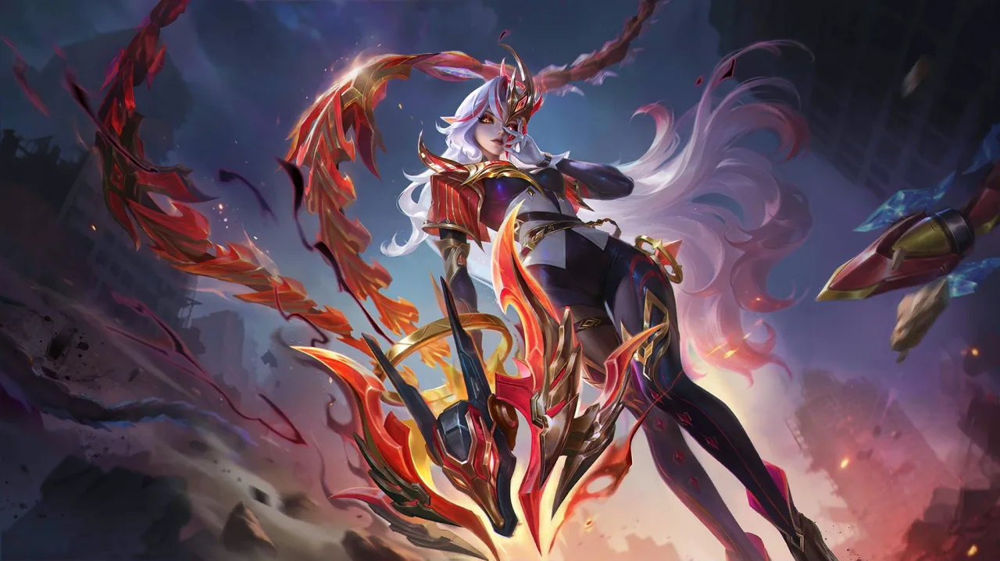

[Tier list](https://boostmlbb.ru/en/heroes/)[Items](https://boostmlbb.ru/en/items/)[Skins](https://boostmlbb.ru/en/skins/)[News & guides](https://boostmlbb.ru/en/news/)

[Skins](https://boostmlbb.ru/en/skins/)/[Obsidia](https://boostmlbb.ru/en/skins/obsidia.html)/Magitech Wraith

[Obsidia skin](https://boostmlbb.ru/en/skins/obsidia.html)

# Magitech Wraith

StarLightLimited

How to get

StarLight skin of May 2026: it was given for buying the StarLight pass that month. Limited skins come back in event draws from time to time.

Released

May 2026

## What the skin changes

-   New look
-   New skill effects
-   Skill sounds
-   Voice-over
-   Skill icons
-   Showcase animation
-   Showcase scene
-   Showcase music
-   Spawn animation
-   Special actions
-   Attribute bonus

## All Obsidia skins [3](https://boostmlbb.ru/en/skins/obsidia.html)

[Imperatrix ArashiGrand · 2026](https://boostmlbb.ru/en/skins/obsidia/imperatrix-arashi.html)[Magitech Wraith2026](https://boostmlbb.ru/en/skins/obsidia/magitech-wraith.html)[Undying RemnantsCommon · 2025](https://boostmlbb.ru/en/skins/obsidia/undying-remnants.html)

## StarLight series

[Tideborn SailorKalea · 2026](https://boostmlbb.ru/en/skins/kalea/tideborn-sailor.html)[Kitsune's ShadowHayabusa · 2026](https://boostmlbb.ru/en/skins/hayabusa/kitsune-s-shadow.html)[Fangs of SlaughterHanzo · 2026](https://boostmlbb.ru/en/skins/hanzo/fangs-of-slaughter.html)[Smoul­dering FortressBelerick · 2026](https://boostmlbb.ru/en/skins/belerick/smouldering-fortress.html)[Elysian LuminanceZetian · 2026](https://boostmlbb.ru/en/skins/zetian/elysian-luminance.html)[Guardian BattalionHilda · 2026](https://boostmlbb.ru/en/skins/hilda/guardian-battalion.html)[Dreaming KoiHarley · 2026](https://boostmlbb.ru/en/skins/harley/dreaming-koi.html)[Royal MarshalFredrinn · 2025](https://boostmlbb.ru/en/skins/fredrinn/royal-marshal.html)

**Rank up on Obsidia**The calculator shows the price

[Calculate price](https://boostmlbb.ru/en/order.html?type=hero)

## Frequently asked questions

How to get the Magitech Wraith skin for Obsidia?

StarLight skin of May 2026: it was given for buying the StarLight pass that month. Limited skins come back in event draws from time to time.

When was Magitech Wraith released?

May 2026.
