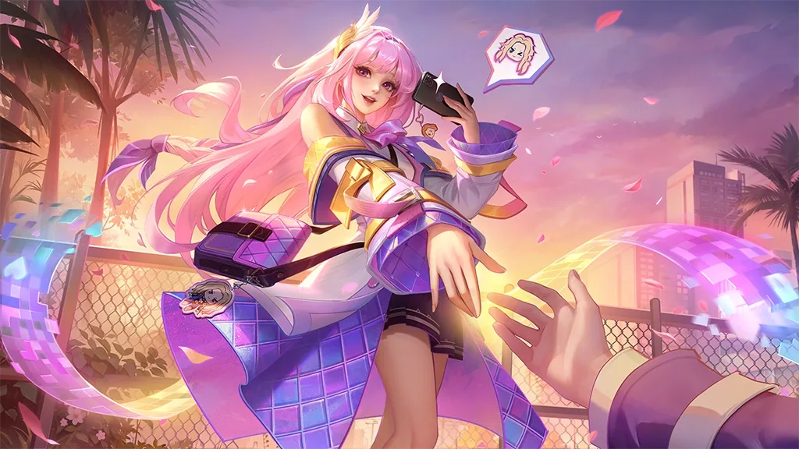

[Tier list](https://boostmlbb.ru/en/heroes/)[Items](https://boostmlbb.ru/en/items/)[Skins](https://boostmlbb.ru/en/skins/)[News & guides](https://boostmlbb.ru/en/news/)

[Skins](https://boostmlbb.ru/en/skins/)/[Odette](https://boostmlbb.ru/en/skins/odette.html)/Song of Devotion

[Odette skin](https://boostmlbb.ru/en/skins/odette.html)

# Song of Devotion

ExquisiteValentine 2026Limited

How to get

Released in the skin shop during an event. Limited skins come back in event draws from time to time.

Released

1 February 2026

## What the skin changes

-   New look
-   New skill effects
-   Skill sounds
-   Voice-over
-   Showcase animation
-   Showcase scene
-   Showcase music
-   Special actions
-   Attribute bonus

## All Odette skins [9](https://boostmlbb.ru/en/skins/odette.html)

[Song of DevotionExquisite · 2026](https://boostmlbb.ru/en/skins/odette/song-of-devotion.html)[Wisdom of the StarsExceptional · 2024](https://boostmlbb.ru/en/skins/odette/wisdom-of-the-stars.html)[Sage of the CurrentsDeluxe · 2020](https://boostmlbb.ru/en/skins/odette/sage-of-the-currents.html)[Auspicious CharmExceptional · 2019](https://boostmlbb.ru/en/skins/odette/auspicious-charm.html)[VirgoDeluxe · 2019](https://boostmlbb.ru/en/skins/odette/virgo.html)[Mermaid PrincessExquisite · 2018](https://boostmlbb.ru/en/skins/odette/mermaid-princess.html)[Butterfly GoddessExceptional · 2018](https://boostmlbb.ru/en/skins/odette/butterfly-goddess.html)[Christmas CarnivalExceptional · 2018](https://boostmlbb.ru/en/skins/odette/christmas-carnival.html)[Black SwanCommon · 2017](https://boostmlbb.ru/en/skins/odette/black-swan.html)

## Valentine 2026 series

[Blade of DevotionLancelot · 2026](https://boostmlbb.ru/en/skins/lancelot/blade-of-devotion.html)

**Rank up on Odette**The calculator shows the price

[Calculate price](https://boostmlbb.ru/en/order.html?type=hero)

## Frequently asked questions

How to get the Song of Devotion skin for Odette?

Released in the skin shop during an event. Limited skins come back in event draws from time to time.

When was Song of Devotion released?

1 February 2026.

What class is Song of Devotion?

Exquisite, Valentine 2026 series.
