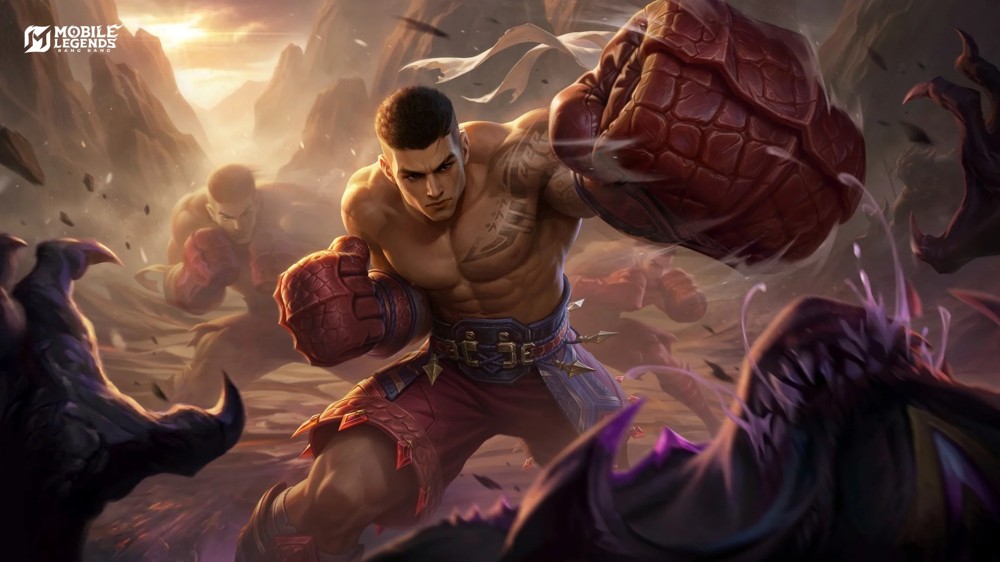

[All skins](https://boostmlbb.ru/en/skins/)

[Skins](https://boostmlbb.ru/en/skins/)/Paquito

# Paquito skins

Skins

8

In the shop

2

Latest

[Fist of Glory](https://boostmlbb.ru/en/skins/paquito/fist-of-glory.html)2024

[Hero profile→](https://boostmlbb.ru/en/heroes/paquito.html)

## All skins

AllGrandExquisiteDeluxeExceptionalCommon

[Fist of GloryDeluxe · 2024](https://boostmlbb.ru/en/skins/paquito/fist-of-glory.html)[Terry BogardGrand · 2024](https://boostmlbb.ru/en/skins/paquito/terry-bogard.html)[Blazing TigerExquisite · 2023](https://boostmlbb.ru/en/skins/paquito/blazing-tiger.html)[Fist of LightExceptional · 2022](https://boostmlbb.ru/en/skins/paquito/fist-of-light.html)[Fulgent PunchExceptional · 2022](https://boostmlbb.ru/en/skins/paquito/fulgent-punch.html)[Underground BoxerExceptional · 2021](https://boostmlbb.ru/en/skins/paquito/underground-boxer.html)[Manny PacquiaoDeluxe · 2021](https://boostmlbb.ru/en/skins/paquito/manny-pacquiao.html)[Death BlowCommon · 2021](https://boostmlbb.ru/en/skins/paquito/death-blow.html)

**How much is a rank boost on Paquito?**Choose your current and target ranks to see the price here.

[Calculate price](https://boostmlbb.ru/en/order.html?type=hero)

## Frequently asked questions

How many skins does Paquito have?

8 skins, the default look not counted. The newest is Fist of Glory (19 September 2024).

Which Paquito skins can you buy now?

Underground Boxer (749 diamonds), Death Blow (269 diamonds). The other skins were limited and come back only in events.

What is the rarest Paquito skin?

Terry Bogard, Grand class, KOF series. Released in the MLBB × The King of Fighters event.
