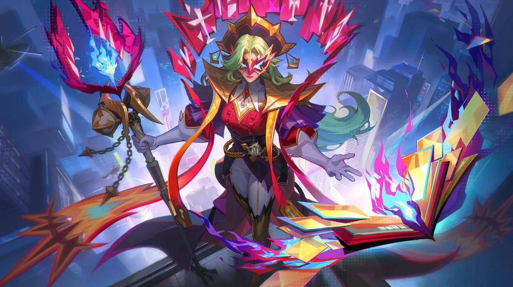
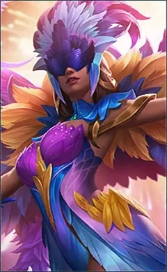

[Tier list](https://boostmlbb.ru/en/heroes/)[Items](https://boostmlbb.ru/en/items/)[Skins](https://boostmlbb.ru/en/skins/)[News & guides](https://boostmlbb.ru/en/news/)

[Skins](https://boostmlbb.ru/en/skins/)/Pharsa

# Pharsa skins

Skins

10

In the shop

3

Latest

[Neobeast Pharsa](https://boostmlbb.ru/en/skins/pharsa/neobeast-pharsa.html)2025

[Hero profile→](https://boostmlbb.ru/en/heroes/pharsa.html)

## All skins

AllGrandExquisiteDeluxeExceptionalCommon

[Neobeast PharsaGrand · 2025](https://boostmlbb.ru/en/skins/pharsa/neobeast-pharsa.html)[Neon ShingetsuDeluxe · 2023](https://boostmlbb.ru/en/skins/pharsa/neon-shingetsu.html)[HierophantDeluxe · 2022](https://boostmlbb.ru/en/skins/pharsa/hierophant.html)[Samba MuseExceptional · 2022](https://boostmlbb.ru/en/skins/pharsa/samba-muse.html)[Peony BloomExceptional · 2021](https://boostmlbb.ru/en/skins/pharsa/peony-bloom.html)[Empress PhoenixExquisite · 2020](https://boostmlbb.ru/en/skins/pharsa/empress-phoenix.html)[Enchanting WitchCommon · 2019](https://boostmlbb.ru/en/skins/pharsa/enchanting-witch.html)[Indigo AviatrixCommon · 2019](https://boostmlbb.ru/en/skins/pharsa/indigo-aviatrix.html)[Peafowl's DanceCommon · 2018](https://boostmlbb.ru/en/skins/pharsa/peafowl-s-dance.html)[Wings of HeavenCommon · 2017](https://boostmlbb.ru/en/skins/pharsa/wings-of-heaven.html)

**Rank up on Pharsa**The calculator shows the price

[Calculate price](https://boostmlbb.ru/en/order.html?type=hero)

## Frequently asked questions

How many skins does Pharsa have?

10 skins, the default look not counted. The newest is Neobeast Pharsa (12 April 2025).

Which Pharsa skins can you buy now?

Neon Shingetsu (899 diamonds), Peafowl's Dance (599 diamonds), Wings of Heaven (269 diamonds). The other skins were limited and come back only in events.

What is the rarest Pharsa skin?

Neobeast Pharsa, Grand class, Neobeast 2 series. Released in the Neobeast 2 event. Limited skins come back in event draws from time to time.
