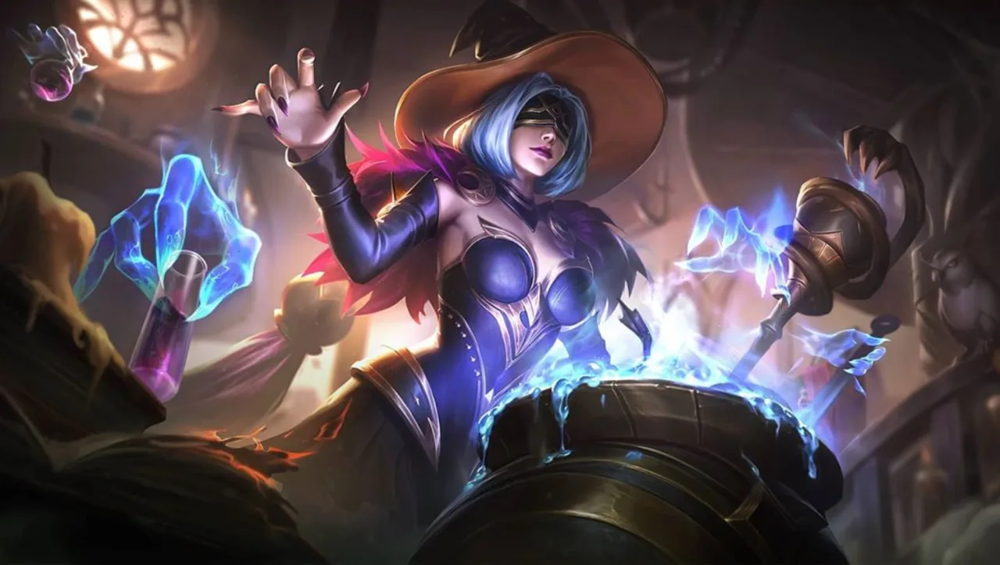

[Pharsa skins](https://boostmlbb.ru/en/skins/pharsa.html)

[Skins](https://boostmlbb.ru/en/skins/)/[Pharsa](https://boostmlbb.ru/en/skins/pharsa.html)/Enchanting Witch

[Pharsa skin](https://boostmlbb.ru/en/skins/pharsa.html)

# Enchanting Witch

CommonSeason 14Limited

How to get

Ranked Season 14 reward.

Released

20 December 2019

## What the skin changes

-   New look
-   Recoloured effects
-   Showcase animation
-   Attribute bonus

## All Pharsa skins [10](https://boostmlbb.ru/en/skins/pharsa.html)

[Neobeast PharsaGrand · 2025](https://boostmlbb.ru/en/skins/pharsa/neobeast-pharsa.html)[Neon ShingetsuDeluxe · 2023](https://boostmlbb.ru/en/skins/pharsa/neon-shingetsu.html)[HierophantDeluxe · 2022](https://boostmlbb.ru/en/skins/pharsa/hierophant.html)[Samba MuseExceptional · 2022](https://boostmlbb.ru/en/skins/pharsa/samba-muse.html)[Peony BloomExceptional · 2021](https://boostmlbb.ru/en/skins/pharsa/peony-bloom.html)[Empress PhoenixExquisite · 2020](https://boostmlbb.ru/en/skins/pharsa/empress-phoenix.html)[Enchanting WitchCommon · 2019](https://boostmlbb.ru/en/skins/pharsa/enchanting-witch.html)[Indigo AviatrixCommon · 2019](https://boostmlbb.ru/en/skins/pharsa/indigo-aviatrix.html)[Peafowl's DanceCommon · 2018](https://boostmlbb.ru/en/skins/pharsa/peafowl-s-dance.html)[Wings of HeavenCommon · 2017](https://boostmlbb.ru/en/skins/pharsa/wings-of-heaven.html)

**How much is a rank boost on Pharsa?**Choose your current and target ranks to see the price here.

[Calculate price](https://boostmlbb.ru/en/order.html?type=hero)

## Frequently asked questions

How to get the Enchanting Witch skin for Pharsa?

Ranked Season 14 reward.

When was Enchanting Witch released?

20 December 2019.

What class is Enchanting Witch?

Common, Season 14 series.
