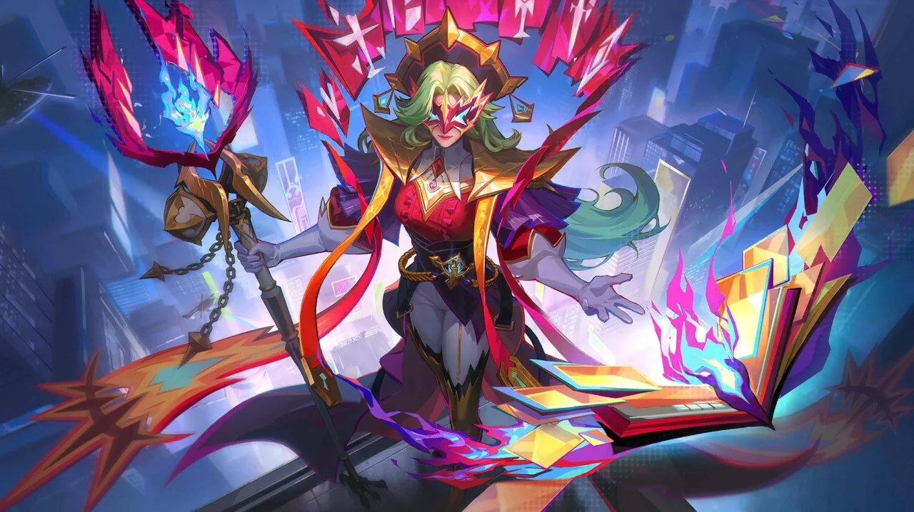

[Tier list](https://boostmlbb.ru/en/heroes/)[Items](https://boostmlbb.ru/en/items/)[Skins](https://boostmlbb.ru/en/skins/)[News & guides](https://boostmlbb.ru/en/news/)

[Skins](https://boostmlbb.ru/en/skins/)/[Pharsa](https://boostmlbb.ru/en/skins/pharsa.html)/Neobeast Pharsa

[Pharsa skin](https://boostmlbb.ru/en/skins/pharsa.html)

# Neobeast Pharsa

GrandNeobeast 2Limited

How to get

Released in the Neobeast 2 event. Limited skins come back in event draws from time to time.

Released

12 April 2025

## What the skin changes

-   New look
-   New skill effects
-   Skill sounds
-   Voice-over
-   Skill icons
-   Showcase animation
-   Showcase scene
-   Showcase music
-   Spawn animation
-   Special actions
-   Attribute bonus

## All Pharsa skins [10](https://boostmlbb.ru/en/skins/pharsa.html)

[Neobeast PharsaGrand · 2025](https://boostmlbb.ru/en/skins/pharsa/neobeast-pharsa.html)[Neon ShingetsuDeluxe · 2023](https://boostmlbb.ru/en/skins/pharsa/neon-shingetsu.html)[HierophantDeluxe · 2022](https://boostmlbb.ru/en/skins/pharsa/hierophant.html)[Samba MuseExceptional · 2022](https://boostmlbb.ru/en/skins/pharsa/samba-muse.html)[Peony BloomExceptional · 2021](https://boostmlbb.ru/en/skins/pharsa/peony-bloom.html)[Empress PhoenixExquisite · 2020](https://boostmlbb.ru/en/skins/pharsa/empress-phoenix.html)[Enchanting WitchCommon · 2019](https://boostmlbb.ru/en/skins/pharsa/enchanting-witch.html)[Indigo AviatrixCommon · 2019](https://boostmlbb.ru/en/skins/pharsa/indigo-aviatrix.html)[Peafowl's DanceCommon · 2018](https://boostmlbb.ru/en/skins/pharsa/peafowl-s-dance.html)[Wings of HeavenCommon · 2017](https://boostmlbb.ru/en/skins/pharsa/wings-of-heaven.html)

## Neobeast 2 series

[Neobeast LingLing · 2025](https://boostmlbb.ru/en/skins/ling/neobeast-ling.html)[Neobeast BrodyBrody · 2025](https://boostmlbb.ru/en/skins/brody/neobeast-brody.html)

**Rank up on Pharsa**The calculator shows the price

[Calculate price](https://boostmlbb.ru/en/order.html?type=hero)

## Frequently asked questions

How to get the Neobeast Pharsa skin for Pharsa?

Released in the Neobeast 2 event. Limited skins come back in event draws from time to time.

When was Neobeast Pharsa released?

12 April 2025.

What class is Neobeast Pharsa?

Grand, Neobeast 2 series.
