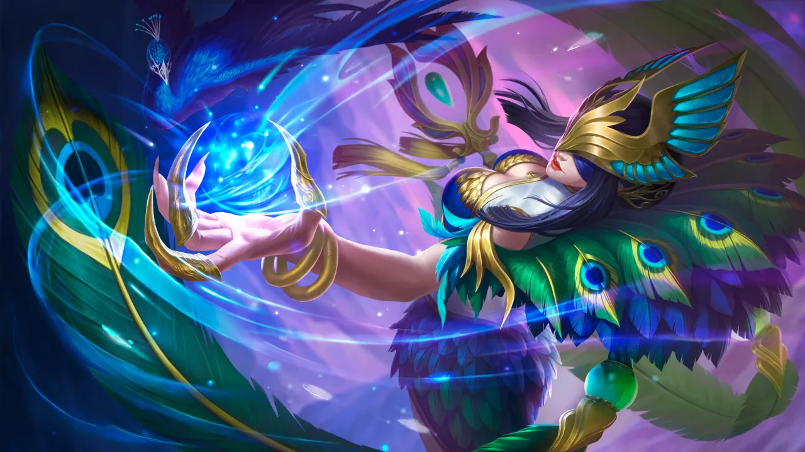

[Pharsa skins](https://boostmlbb.ru/en/skins/pharsa.html)

[Skins](https://boostmlbb.ru/en/skins/)/[Pharsa](https://boostmlbb.ru/en/skins/pharsa.html)/Peafowl's Dance

[Pharsa skin](https://boostmlbb.ru/en/skins/pharsa.html)

# Peafowl's Dance

CommonEliteIn the shop

How to get

Sold in the skin shop for 599 diamonds.

Price

599 diamonds

Released

22 April 2018

## What the skin changes

-   New look
-   Recoloured effects
-   Showcase animation
-   Attribute bonus

## All Pharsa skins [10](https://boostmlbb.ru/en/skins/pharsa.html)

[Neobeast PharsaGrand · 2025](https://boostmlbb.ru/en/skins/pharsa/neobeast-pharsa.html)[Neon ShingetsuDeluxe · 2023](https://boostmlbb.ru/en/skins/pharsa/neon-shingetsu.html)[HierophantDeluxe · 2022](https://boostmlbb.ru/en/skins/pharsa/hierophant.html)[Samba MuseExceptional · 2022](https://boostmlbb.ru/en/skins/pharsa/samba-muse.html)[Peony BloomExceptional · 2021](https://boostmlbb.ru/en/skins/pharsa/peony-bloom.html)[Empress PhoenixExquisite · 2020](https://boostmlbb.ru/en/skins/pharsa/empress-phoenix.html)[Enchanting WitchCommon · 2019](https://boostmlbb.ru/en/skins/pharsa/enchanting-witch.html)[Indigo AviatrixCommon · 2019](https://boostmlbb.ru/en/skins/pharsa/indigo-aviatrix.html)[Peafowl's DanceCommon · 2018](https://boostmlbb.ru/en/skins/pharsa/peafowl-s-dance.html)[Wings of HeavenCommon · 2017](https://boostmlbb.ru/en/skins/pharsa/wings-of-heaven.html)

## Elite series

[Golden OsmanthusChang'e · 2026](https://boostmlbb.ru/en/skins/change/golden-osmanthus.html)[Warlord KingMartis · 2025](https://boostmlbb.ru/en/skins/martis/warlord-king.html)[High Seas CadetKimmy · 2024](https://boostmlbb.ru/en/skins/kimmy/high-seas-cadet.html)[Verdant LancerSilvanna · 2024](https://boostmlbb.ru/en/skins/silvanna/verdant-lancer.html)[Bloodhoof MarauderHylos · 2024](https://boostmlbb.ru/en/skins/hylos/bloodhoof-marauder.html)[Elegant ButterflyGuinevere · 2024](https://boostmlbb.ru/en/skins/guinevere/elegant-butterfly.html)[Marques of BladesLancelot · 2024](https://boostmlbb.ru/en/skins/lancelot/marques-of-blades.html)[Badlands HiatusChip · 2024](https://boostmlbb.ru/en/skins/chip/badlands-hiatus.html)

**How much is a rank boost on Pharsa?**Choose your current and target ranks to see the price here.

[Calculate price](https://boostmlbb.ru/en/order.html?type=hero)

## Frequently asked questions

How to get the Peafowl's Dance skin for Pharsa?

Sold in the skin shop for 599 diamonds.

When was Peafowl's Dance released?

22 April 2018.

What class is Peafowl's Dance?

Common, Elite series.
