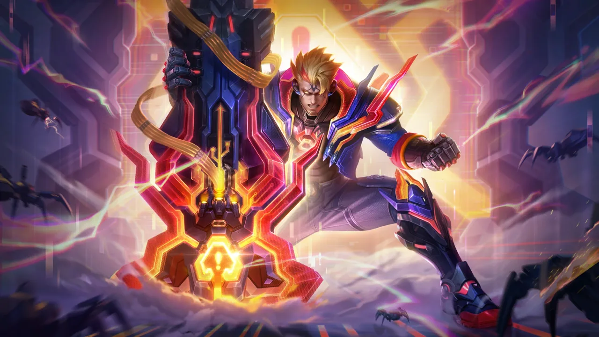

[Tier list](https://boostmlbb.ru/en/heroes/)[Items](https://boostmlbb.ru/en/items/)[Skins](https://boostmlbb.ru/en/skins/)[News & guides](https://boostmlbb.ru/en/news/)

[Skins](https://boostmlbb.ru/en/skins/)/[Phoveus](https://boostmlbb.ru/en/skins/phoveus.html)/Matrix Maverick

[Phoveus skin](https://boostmlbb.ru/en/skins/phoveus.html)

# Matrix Maverick

ExceptionalStarLightLimited

How to get

StarLight reward for July 2025.

Released

1 July 2025

## What the skin changes

-   New look
-   New skill effects
-   Showcase animation
-   Showcase scene
-   Attribute bonus

## All Phoveus skins [2](https://boostmlbb.ru/en/skins/phoveus.html)

[Matrix MaverickExceptional · 2025](https://boostmlbb.ru/en/skins/phoveus/matrix-maverick.html)[Monolith WatcherCommon · 2021](https://boostmlbb.ru/en/skins/phoveus/monolith-watcher.html)

## StarLight series

[Tideborn SailorKalea · 2026](https://boostmlbb.ru/en/skins/kalea/tideborn-sailor.html)[Kitsune's ShadowHayabusa · 2026](https://boostmlbb.ru/en/skins/hayabusa/kitsune-s-shadow.html)[Fangs of SlaughterHanzo · 2026](https://boostmlbb.ru/en/skins/hanzo/fangs-of-slaughter.html)[Smoul­dering FortressBelerick · 2026](https://boostmlbb.ru/en/skins/belerick/smouldering-fortress.html)[Magitech WraithObsidia · 2026](https://boostmlbb.ru/en/skins/obsidia/magitech-wraith.html)[Elysian LuminanceZetian · 2026](https://boostmlbb.ru/en/skins/zetian/elysian-luminance.html)[Guardian BattalionHilda · 2026](https://boostmlbb.ru/en/skins/hilda/guardian-battalion.html)[Dreaming KoiHarley · 2026](https://boostmlbb.ru/en/skins/harley/dreaming-koi.html)

**Rank up on Phoveus**The calculator shows the price

[Calculate price](https://boostmlbb.ru/en/order.html?type=hero)

## Frequently asked questions

How to get the Matrix Maverick skin for Phoveus?

StarLight reward for July 2025.

When was Matrix Maverick released?

1 July 2025.

What class is Matrix Maverick?

Exceptional, StarLight series.
