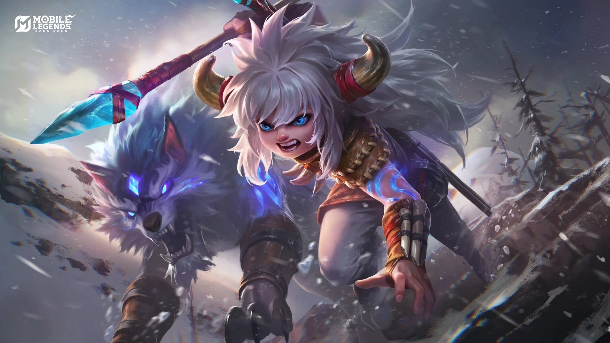

[All skins](https://boostmlbb.ru/en/skins/)

[Skins](https://boostmlbb.ru/en/skins/)/Popol and Kupa

# Popol and Kupa skins

Skins

6

In the shop

2

Latest

[Proto Hunter](https://boostmlbb.ru/en/skins/popol-and-kupa/proto-hunter.html)2025

[Hero profile→](https://boostmlbb.ru/en/heroes/popol-and-kupa.html)

## All skins

[Proto HunterExceptional · 2025](https://boostmlbb.ru/en/skins/popol-and-kupa/proto-hunter.html)[Spirit of the BrushExquisite · 2023](https://boostmlbb.ru/en/skins/popol-and-kupa/spirit-of-the-brush.html)[Trouble MakersExceptional · 2022](https://boostmlbb.ru/en/skins/popol-and-kupa/trouble-makers.html)[Soundwave & RavageGrand · 2022](https://boostmlbb.ru/en/skins/popol-and-kupa/soundwave-ravage.html)[Tribal HowlCommon · 2020](https://boostmlbb.ru/en/skins/popol-and-kupa/tribal-howl.html)[Hunting PalsCommon · 2020](https://boostmlbb.ru/en/skins/popol-and-kupa/hunting-pals.html)

**How much is a rank boost on Popol and Kupa?**Choose your current and target ranks to see the price here.

[Calculate price](https://boostmlbb.ru/en/order.html?type=hero)

## Frequently asked questions

How many skins does Popol and Kupa have?

6 skins, the default look not counted. The newest is Proto Hunter (27 June 2025).

Which Popol and Kupa skins can you buy now?

Tribal Howl (599 diamonds), Hunting Pals (269 diamonds). The other skins were limited and come back only in events.

What is the rarest Popol and Kupa skin?

Soundwave & Ravage, Grand class, Transformers series. Released in the MLBB × Transformers collaboration event. Limited skins come back in event draws from time to time.
