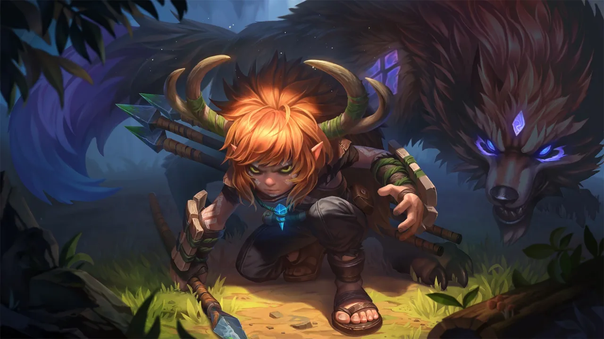
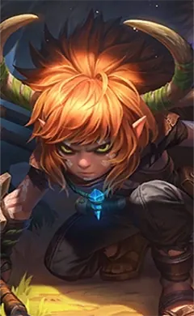

[Tier list](https://boostmlbb.ru/en/heroes/)[Items](https://boostmlbb.ru/en/items/)[Skins](https://boostmlbb.ru/en/skins/)[News & guides](https://boostmlbb.ru/en/news/)

[Skins](https://boostmlbb.ru/en/skins/)/[Popol and Kupa](https://boostmlbb.ru/en/skins/popol-and-kupa.html)/Hunting Pals

[Popol and Kupa skin](https://boostmlbb.ru/en/skins/popol-and-kupa.html)

# Hunting Pals

CommonIn the shop

How to get

Sold in the skin shop for 269 diamonds.

Price

269 diamonds

Released

21 April 2020

## What the skin changes

-   Attribute bonus

## All Popol and Kupa skins [6](https://boostmlbb.ru/en/skins/popol-and-kupa.html)

[Proto HunterExceptional · 2025](https://boostmlbb.ru/en/skins/popol-and-kupa/proto-hunter.html)[Spirit of the BrushExquisite · 2023](https://boostmlbb.ru/en/skins/popol-and-kupa/spirit-of-the-brush.html)[Trouble MakersExceptional · 2022](https://boostmlbb.ru/en/skins/popol-and-kupa/trouble-makers.html)[Soundwave & RavageGrand · 2022](https://boostmlbb.ru/en/skins/popol-and-kupa/soundwave-ravage.html)[Tribal HowlCommon · 2020](https://boostmlbb.ru/en/skins/popol-and-kupa/tribal-howl.html)[Hunting PalsCommon · 2020](https://boostmlbb.ru/en/skins/popol-and-kupa/hunting-pals.html)

**Rank up on Popol and Kupa**The calculator shows the price

[Calculate price](https://boostmlbb.ru/en/order.html?type=hero)

## Frequently asked questions

How to get the Hunting Pals skin for Popol and Kupa?

Sold in the skin shop for 269 diamonds.

When was Hunting Pals released?

21 April 2020.

What class is Hunting Pals?

Common.
