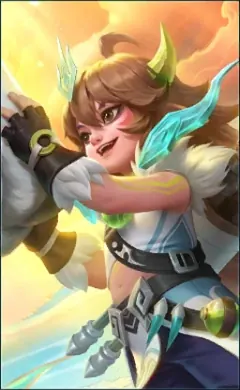

[Popol and Kupa skins](https://boostmlbb.ru/en/skins/popol-and-kupa.html)

[Skins](https://boostmlbb.ru/en/skins/)/[Popol and Kupa](https://boostmlbb.ru/en/skins/popol-and-kupa.html)/Soundwave & Ravage

[Popol and Kupa skin](https://boostmlbb.ru/en/skins/popol-and-kupa.html)

# Soundwave & Ravage

GrandTransformersLimited

How to get

Released in the MLBB × Transformers collaboration event. Limited skins come back in event draws from time to time.

Released

24 May 2022

## What the skin changes

-   New look
-   New skill effects
-   Skill sounds
-   Voice-over
-   Showcase animation
-   Showcase scene
-   Showcase music
-   Special actions
-   Attribute bonus

## All Popol and Kupa skins [6](https://boostmlbb.ru/en/skins/popol-and-kupa.html)

[Proto HunterExceptional · 2025](https://boostmlbb.ru/en/skins/popol-and-kupa/proto-hunter.html)[Spirit of the BrushExquisite · 2023](https://boostmlbb.ru/en/skins/popol-and-kupa/spirit-of-the-brush.html)[Trouble MakersExceptional · 2022](https://boostmlbb.ru/en/skins/popol-and-kupa/trouble-makers.html)[Soundwave & RavageGrand · 2022](https://boostmlbb.ru/en/skins/popol-and-kupa/soundwave-ravage.html)[Tribal HowlCommon · 2020](https://boostmlbb.ru/en/skins/popol-and-kupa/tribal-howl.html)[Hunting PalsCommon · 2020](https://boostmlbb.ru/en/skins/popol-and-kupa/hunting-pals.html)

## Transformers series

[BumblebeeX.Borg · 2025](https://boostmlbb.ru/en/skins/x-borg/bumblebee.html)[Optimus PrimeJohnson · 2023](https://boostmlbb.ru/en/skins/johnson/optimus-prime.html)[MegatronGranger · 2023](https://boostmlbb.ru/en/skins/granger/megatron.html)[StarscreamAldous · 2022](https://boostmlbb.ru/en/skins/aldous/starscream.html)[GrimlockRoger · 2022](https://boostmlbb.ru/en/skins/roger/grimlock.html)

**How much is a rank boost on Popol and Kupa?**Choose your current and target ranks to see the price here.

[Calculate price](https://boostmlbb.ru/en/order.html?type=hero)

## Frequently asked questions

How to get the Soundwave & Ravage skin for Popol and Kupa?

Released in the MLBB × Transformers collaboration event. Limited skins come back in event draws from time to time.

When was Soundwave & Ravage released?

24 May 2022.

What class is Soundwave & Ravage?

Grand, Transformers series.
