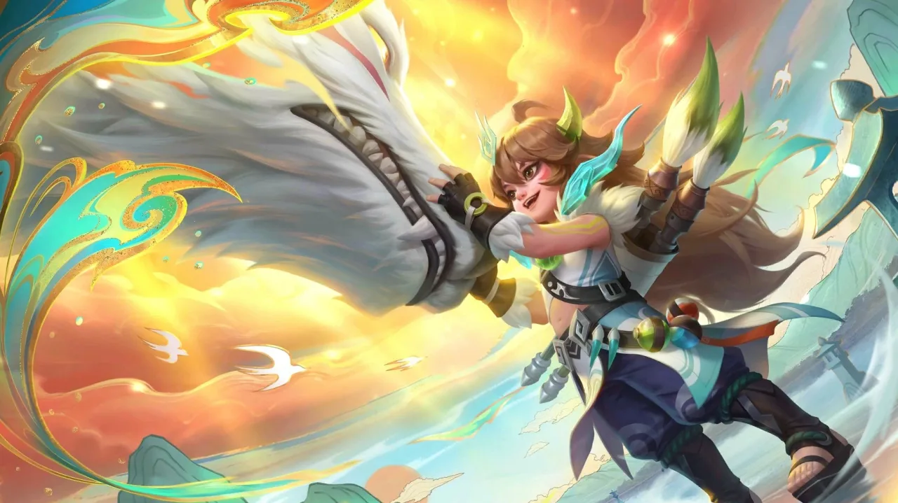

[Tier list](https://boostmlbb.ru/en/heroes/)[Items](https://boostmlbb.ru/en/items/)[Skins](https://boostmlbb.ru/en/skins/)[News & guides](https://boostmlbb.ru/en/news/)

[Skins](https://boostmlbb.ru/en/skins/)/[Popol and Kupa](https://boostmlbb.ru/en/skins/popol-and-kupa.html)/Spirit of the Brush

[Popol and Kupa skin](https://boostmlbb.ru/en/skins/popol-and-kupa.html)

# Spirit of the Brush

ExquisiteCollectorLimited

How to get

The top prize of a Collector event draw, paid with diamonds. Limited skins come back in event draws from time to time.

Released

10 November 2023

## What the skin changes

-   New look
-   New skill effects
-   Skill sounds
-   Voice-over
-   Showcase animation
-   Showcase scene
-   Showcase music
-   Special actions
-   Attribute bonus

## All Popol and Kupa skins [6](https://boostmlbb.ru/en/skins/popol-and-kupa.html)

[Proto HunterExceptional · 2025](https://boostmlbb.ru/en/skins/popol-and-kupa/proto-hunter.html)[Spirit of the BrushExquisite · 2023](https://boostmlbb.ru/en/skins/popol-and-kupa/spirit-of-the-brush.html)[Trouble MakersExceptional · 2022](https://boostmlbb.ru/en/skins/popol-and-kupa/trouble-makers.html)[Soundwave & RavageGrand · 2022](https://boostmlbb.ru/en/skins/popol-and-kupa/soundwave-ravage.html)[Tribal HowlCommon · 2020](https://boostmlbb.ru/en/skins/popol-and-kupa/tribal-howl.html)[Hunting PalsCommon · 2020](https://boostmlbb.ru/en/skins/popol-and-kupa/hunting-pals.html)

## Collector series

[The PurifierBruno · 2026](https://boostmlbb.ru/en/skins/bruno/the-purifier.html)[Celestial RebelSun · 2026](https://boostmlbb.ru/en/skins/sun/celestial-rebel.html)[Kaiju of the DeepHelcurt · 2026](https://boostmlbb.ru/en/skins/helcurt/kaiju-of-the-deep.html)[Starbound SentryKimmy · 2026](https://boostmlbb.ru/en/skins/kimmy/starbound-sentry.html)[Dreaming MonarchAlice · 2026](https://boostmlbb.ru/en/skins/alice/dreaming-monarch.html)[Tremor of the DeepGrock · 2026](https://boostmlbb.ru/en/skins/grock/tremor-of-the-deep.html)[Celestial GeneralTigreal · 2026](https://boostmlbb.ru/en/skins/tigreal/celestial-general.html)[Sunborn MonarchXavier · 2026](https://boostmlbb.ru/en/skins/xavier/sunborn-monarch.html)

**Rank up on Popol and Kupa**The calculator shows the price

[Calculate price](https://boostmlbb.ru/en/order.html?type=hero)

## Frequently asked questions

How to get the Spirit of the Brush skin for Popol and Kupa?

The top prize of a Collector event draw, paid with diamonds. Limited skins come back in event draws from time to time.

When was Spirit of the Brush released?

10 November 2023.

What class is Spirit of the Brush?

Exquisite, Collector series.
