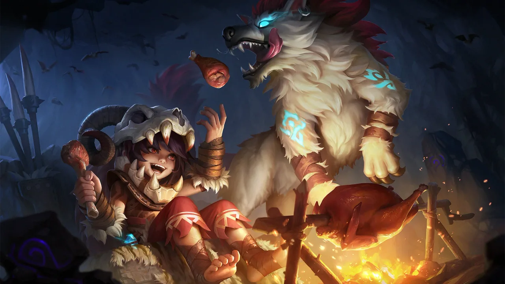
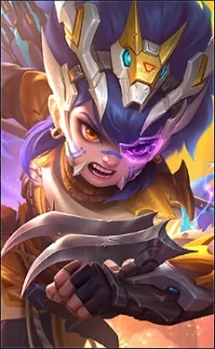
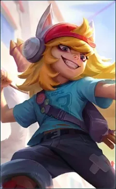

[Popol and Kupa skins](https://boostmlbb.ru/en/skins/popol-and-kupa.html)

[Skins](https://boostmlbb.ru/en/skins/)/[Popol and Kupa](https://boostmlbb.ru/en/skins/popol-and-kupa.html)/Tribal Howl

[Popol and Kupa skin](https://boostmlbb.ru/en/skins/popol-and-kupa.html)

# Tribal Howl

CommonEliteIn the shop

How to get

Sold in the skin shop for 599 diamonds.

Price

599 diamonds

Released

28 September 2020

## What the skin changes

-   New look
-   Recoloured effects
-   Showcase animation
-   Attribute bonus

## All Popol and Kupa skins [6](https://boostmlbb.ru/en/skins/popol-and-kupa.html)

[Proto HunterExceptional · 2025](https://boostmlbb.ru/en/skins/popol-and-kupa/proto-hunter.html)[Spirit of the BrushExquisite · 2023](https://boostmlbb.ru/en/skins/popol-and-kupa/spirit-of-the-brush.html)[Trouble MakersExceptional · 2022](https://boostmlbb.ru/en/skins/popol-and-kupa/trouble-makers.html)[Soundwave & RavageGrand · 2022](https://boostmlbb.ru/en/skins/popol-and-kupa/soundwave-ravage.html)[Tribal HowlCommon · 2020](https://boostmlbb.ru/en/skins/popol-and-kupa/tribal-howl.html)[Hunting PalsCommon · 2020](https://boostmlbb.ru/en/skins/popol-and-kupa/hunting-pals.html)

## Elite series

[Golden OsmanthusChang'e · 2026](https://boostmlbb.ru/en/skins/change/golden-osmanthus.html)[Warlord KingMartis · 2025](https://boostmlbb.ru/en/skins/martis/warlord-king.html)[High Seas CadetKimmy · 2024](https://boostmlbb.ru/en/skins/kimmy/high-seas-cadet.html)[Verdant LancerSilvanna · 2024](https://boostmlbb.ru/en/skins/silvanna/verdant-lancer.html)[Bloodhoof MarauderHylos · 2024](https://boostmlbb.ru/en/skins/hylos/bloodhoof-marauder.html)[Elegant ButterflyGuinevere · 2024](https://boostmlbb.ru/en/skins/guinevere/elegant-butterfly.html)[Marques of BladesLancelot · 2024](https://boostmlbb.ru/en/skins/lancelot/marques-of-blades.html)[Badlands HiatusChip · 2024](https://boostmlbb.ru/en/skins/chip/badlands-hiatus.html)

**How much is a rank boost on Popol and Kupa?**Choose your current and target ranks to see the price here.

[Calculate price](https://boostmlbb.ru/en/order.html?type=hero)

## Frequently asked questions

How to get the Tribal Howl skin for Popol and Kupa?

Sold in the skin shop for 599 diamonds.

When was Tribal Howl released?

28 September 2020.

What class is Tribal Howl?

Common, Elite series.
