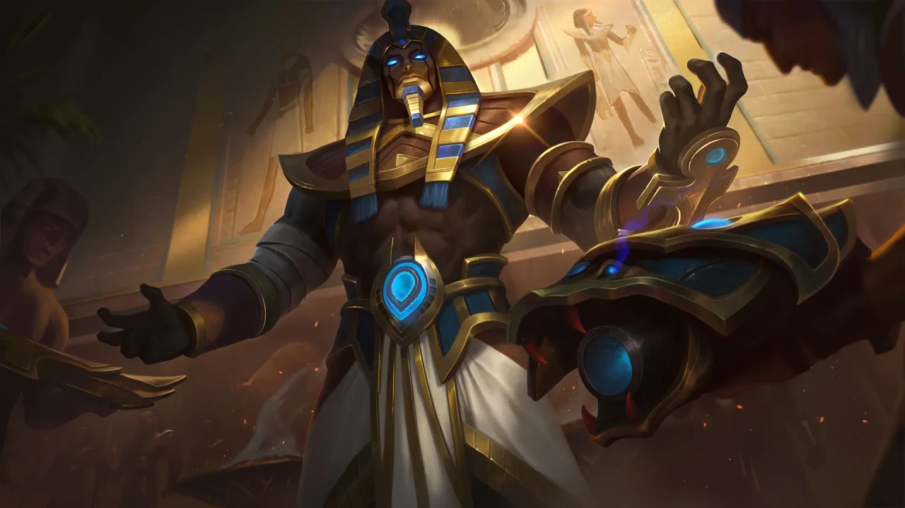

[Tier list](https://boostmlbb.ru/en/heroes/)[Items](https://boostmlbb.ru/en/items/)[Skins](https://boostmlbb.ru/en/skins/)[News & guides](https://boostmlbb.ru/en/news/)

[Skins](https://boostmlbb.ru/en/skins/)/[Roger](https://boostmlbb.ru/en/skins/roger.html)/Anubis

[Roger skin](https://boostmlbb.ru/en/skins/roger.html)

# Anubis

ExceptionalStarLightLimited

How to get

StarLight reward for February 2018.

Released

1 February 2018

## What the skin changes

-   New look
-   New skill effects
-   Showcase animation
-   Attribute bonus

## All Roger skins [8](https://boostmlbb.ru/en/skins/roger.html)

[GrimlockGrand · 2022](https://boostmlbb.ru/en/skins/roger/grimlock.html)[Phantom RangerDeluxe · 2021](https://boostmlbb.ru/en/skins/roger/phantom-ranger.html)[Fiend HunterGrand · 2021](https://boostmlbb.ru/en/skins/roger/fiend-hunter.html)[Cyborg WerewolfDeluxe · 2021](https://boostmlbb.ru/en/skins/roger/cyborg-werewolf.html)[Phantom HunterDeluxe · 2018](https://boostmlbb.ru/en/skins/roger/phantom-hunter.html)[AnubisExceptional · 2018](https://boostmlbb.ru/en/skins/roger/anubis.html)[Dr. BeastExquisite · 2017](https://boostmlbb.ru/en/skins/roger/dr-beast.html)[Dark GentCommon · 2017](https://boostmlbb.ru/en/skins/roger/dark-gent.html)

## StarLight series

[Tideborn SailorKalea · 2026](https://boostmlbb.ru/en/skins/kalea/tideborn-sailor.html)[Kitsune's ShadowHayabusa · 2026](https://boostmlbb.ru/en/skins/hayabusa/kitsune-s-shadow.html)[Fangs of SlaughterHanzo · 2026](https://boostmlbb.ru/en/skins/hanzo/fangs-of-slaughter.html)[Smoul­dering FortressBelerick · 2026](https://boostmlbb.ru/en/skins/belerick/smouldering-fortress.html)[Magitech WraithObsidia · 2026](https://boostmlbb.ru/en/skins/obsidia/magitech-wraith.html)[Elysian LuminanceZetian · 2026](https://boostmlbb.ru/en/skins/zetian/elysian-luminance.html)[Guardian BattalionHilda · 2026](https://boostmlbb.ru/en/skins/hilda/guardian-battalion.html)[Dreaming KoiHarley · 2026](https://boostmlbb.ru/en/skins/harley/dreaming-koi.html)

**Rank up on Roger**The calculator shows the price

[Calculate price](https://boostmlbb.ru/en/order.html?type=hero)

## Frequently asked questions

How to get the Anubis skin for Roger?

StarLight reward for February 2018.

When was Anubis released?

1 February 2018.

What class is Anubis?

Exceptional, StarLight series.
