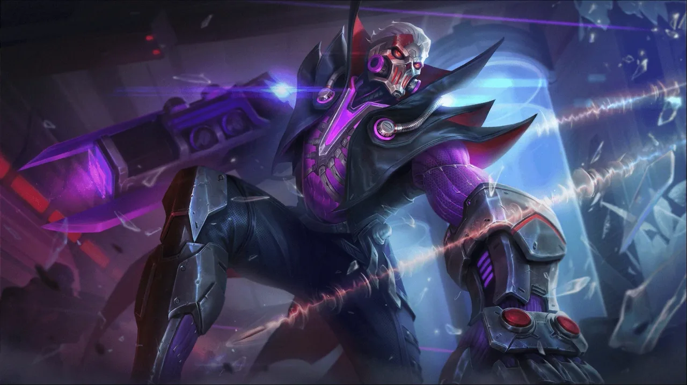

[Tier list](https://boostmlbb.ru/en/heroes/)[Items](https://boostmlbb.ru/en/items/)[Skins](https://boostmlbb.ru/en/skins/)[News & guides](https://boostmlbb.ru/en/news/)

[Skins](https://boostmlbb.ru/en/skins/)/[Roger](https://boostmlbb.ru/en/skins/roger.html)/Cyborg Werewolf

[Roger skin](https://boostmlbb.ru/en/skins/roger.html)

# Cyborg Werewolf

DeluxeEpicLimited

How to get

Released in the skin shop during an event. Limited skins come back in event draws from time to time.

Released

2 January 2021

## What the skin changes

-   New look
-   New skill effects
-   Showcase animation
-   Showcase scene
-   Attribute bonus

## All Roger skins [8](https://boostmlbb.ru/en/skins/roger.html)

[GrimlockGrand · 2022](https://boostmlbb.ru/en/skins/roger/grimlock.html)[Phantom RangerDeluxe · 2021](https://boostmlbb.ru/en/skins/roger/phantom-ranger.html)[Fiend HunterGrand · 2021](https://boostmlbb.ru/en/skins/roger/fiend-hunter.html)[Cyborg WerewolfDeluxe · 2021](https://boostmlbb.ru/en/skins/roger/cyborg-werewolf.html)[Phantom HunterDeluxe · 2018](https://boostmlbb.ru/en/skins/roger/phantom-hunter.html)[AnubisExceptional · 2018](https://boostmlbb.ru/en/skins/roger/anubis.html)[Dr. BeastExquisite · 2017](https://boostmlbb.ru/en/skins/roger/dr-beast.html)[Dark GentCommon · 2017](https://boostmlbb.ru/en/skins/roger/dark-gent.html)

## Epic series

[Nether OverseerMinotaur · 2026](https://boostmlbb.ru/en/skins/minotaur/nether-overseer.html)[Sunken CurseAtlas · 2026](https://boostmlbb.ru/en/skins/atlas/sunken-curse.html)[Eternal VowVexana · 2026](https://boostmlbb.ru/en/skins/vexana/eternal-vow.html)[Cursed ScrollKhufra · 2025](https://boostmlbb.ru/en/skins/khufra/cursed-scroll.html)[Soul HuntressNatalia · 2025](https://boostmlbb.ru/en/skins/natalia/soul-huntress.html)[Nightmare CountLeomord · 2025](https://boostmlbb.ru/en/skins/leomord/nightmare-count.html)[Arbiter of StarsBelerick · 2025](https://boostmlbb.ru/en/skins/belerick/arbiter-of-stars.html)[Keeper of the WindsVale · 2025](https://boostmlbb.ru/en/skins/vale/keeper-of-the-winds.html)

**Rank up on Roger**The calculator shows the price

[Calculate price](https://boostmlbb.ru/en/order.html?type=hero)

## Frequently asked questions

How to get the Cyborg Werewolf skin for Roger?

Released in the skin shop during an event. Limited skins come back in event draws from time to time.

When was Cyborg Werewolf released?

2 January 2021.

What class is Cyborg Werewolf?

Deluxe, Epic series.
