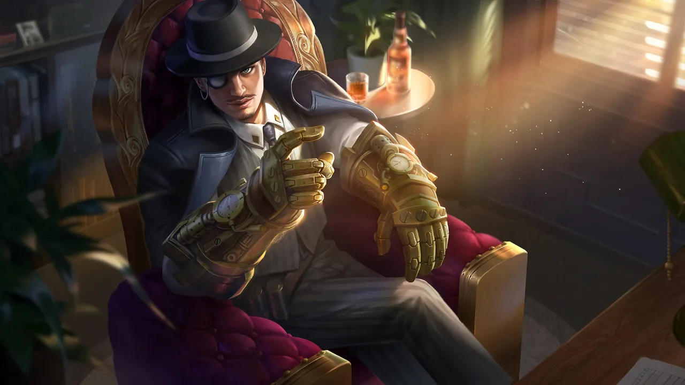

[Roger skins](https://boostmlbb.ru/en/skins/roger.html)

[Skins](https://boostmlbb.ru/en/skins/)/[Roger](https://boostmlbb.ru/en/skins/roger.html)/Dark Gent

[Roger skin](https://boostmlbb.ru/en/skins/roger.html)

# Dark Gent

CommonIn the shop

How to get

Sold in the skin shop for 269 diamonds.

Price

269 diamonds

Released

11 August 2017

## What the skin changes

-   Attribute bonus

## All Roger skins [8](https://boostmlbb.ru/en/skins/roger.html)

[GrimlockGrand · 2022](https://boostmlbb.ru/en/skins/roger/grimlock.html)[Phantom RangerDeluxe · 2021](https://boostmlbb.ru/en/skins/roger/phantom-ranger.html)[Fiend HunterGrand · 2021](https://boostmlbb.ru/en/skins/roger/fiend-hunter.html)[Cyborg WerewolfDeluxe · 2021](https://boostmlbb.ru/en/skins/roger/cyborg-werewolf.html)[Phantom HunterDeluxe · 2018](https://boostmlbb.ru/en/skins/roger/phantom-hunter.html)[AnubisExceptional · 2018](https://boostmlbb.ru/en/skins/roger/anubis.html)[Dr. BeastExquisite · 2017](https://boostmlbb.ru/en/skins/roger/dr-beast.html)[Dark GentCommon · 2017](https://boostmlbb.ru/en/skins/roger/dark-gent.html)

**How much is a rank boost on Roger?**Choose your current and target ranks to see the price here.

[Calculate price](https://boostmlbb.ru/en/order.html?type=hero)

## Frequently asked questions

How to get the Dark Gent skin for Roger?

Sold in the skin shop for 269 diamonds.

When was Dark Gent released?

11 August 2017.

What class is Dark Gent?

Common.
