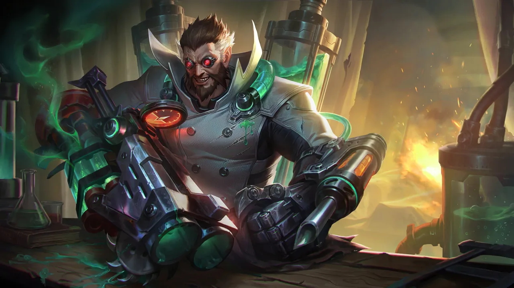

[Tier list](https://boostmlbb.ru/en/heroes/)[Items](https://boostmlbb.ru/en/items/)[Skins](https://boostmlbb.ru/en/skins/)[News & guides](https://boostmlbb.ru/en/news/)

[Skins](https://boostmlbb.ru/en/skins/)/[Roger](https://boostmlbb.ru/en/skins/roger.html)/Dr. Beast

[Roger skin](https://boostmlbb.ru/en/skins/roger.html)

# Dr. Beast

ExquisiteLuckyboxLimited

How to get

Came out of Lucky Boxes in events. Limited skins come back in event draws from time to time.

Released

2 October 2017

## What the skin changes

-   New look
-   New skill effects
-   Showcase animation
-   Showcase scene
-   Attribute bonus

## All Roger skins [8](https://boostmlbb.ru/en/skins/roger.html)

[GrimlockGrand · 2022](https://boostmlbb.ru/en/skins/roger/grimlock.html)[Phantom RangerDeluxe · 2021](https://boostmlbb.ru/en/skins/roger/phantom-ranger.html)[Fiend HunterGrand · 2021](https://boostmlbb.ru/en/skins/roger/fiend-hunter.html)[Cyborg WerewolfDeluxe · 2021](https://boostmlbb.ru/en/skins/roger/cyborg-werewolf.html)[Phantom HunterDeluxe · 2018](https://boostmlbb.ru/en/skins/roger/phantom-hunter.html)[AnubisExceptional · 2018](https://boostmlbb.ru/en/skins/roger/anubis.html)[Dr. BeastExquisite · 2017](https://boostmlbb.ru/en/skins/roger/dr-beast.html)[Dark GentCommon · 2017](https://boostmlbb.ru/en/skins/roger/dark-gent.html)

## Luckybox series

[Lady CraneGuinevere · 2025](https://boostmlbb.ru/en/skins/guinevere/lady-crane.html)[Butterfly SeraphimLunox · 2025](https://boostmlbb.ru/en/skins/lunox/butterfly-seraphim.html)[Mecha DragonClaude · 2025](https://boostmlbb.ru/en/skins/claude/mecha-dragon.html)[Lunar MagicChang'e · 2020](https://boostmlbb.ru/en/skins/change/lunar-magic.html)[Thunder FlashSelena · 2020](https://boostmlbb.ru/en/skins/selena/thunder-flash.html)[RaksheshaHanabi · 2020](https://boostmlbb.ru/en/skins/hanabi/rakshesha.html)[Video-Game DominatorUranus · 2020](https://boostmlbb.ru/en/skins/uranus/video-game-dominator.html)[God of WarMartis · 2020](https://boostmlbb.ru/en/skins/martis/god-of-war.html)

**Rank up on Roger**The calculator shows the price

[Calculate price](https://boostmlbb.ru/en/order.html?type=hero)

## Frequently asked questions

How to get the Dr. Beast skin for Roger?

Came out of Lucky Boxes in events. Limited skins come back in event draws from time to time.

When was Dr. Beast released?

2 October 2017.

What class is Dr. Beast?

Exquisite, Luckybox series.
