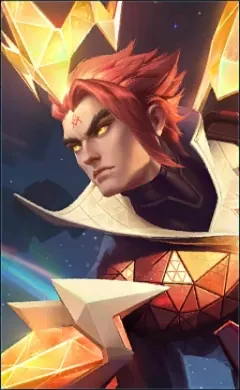

[Roger skins](https://boostmlbb.ru/en/skins/roger.html)

[Skins](https://boostmlbb.ru/en/skins/)/[Roger](https://boostmlbb.ru/en/skins/roger.html)/Fiend Hunter

[Roger skin](https://boostmlbb.ru/en/skins/roger.html)

# Fiend Hunter

GrandPRIMELimited

How to get

M3 Pass reward.

Released

3 November 2021

## What the skin changes

-   New look
-   New skill effects
-   Skill sounds
-   Voice-over
-   Showcase animation
-   Showcase scene
-   Attribute bonus

## All Roger skins [8](https://boostmlbb.ru/en/skins/roger.html)

[GrimlockGrand · 2022](https://boostmlbb.ru/en/skins/roger/grimlock.html)[Phantom RangerDeluxe · 2021](https://boostmlbb.ru/en/skins/roger/phantom-ranger.html)[Fiend HunterGrand · 2021](https://boostmlbb.ru/en/skins/roger/fiend-hunter.html)[Cyborg WerewolfDeluxe · 2021](https://boostmlbb.ru/en/skins/roger/cyborg-werewolf.html)[Phantom HunterDeluxe · 2018](https://boostmlbb.ru/en/skins/roger/phantom-hunter.html)[AnubisExceptional · 2018](https://boostmlbb.ru/en/skins/roger/anubis.html)[Dr. BeastExquisite · 2017](https://boostmlbb.ru/en/skins/roger/dr-beast.html)[Dark GentCommon · 2017](https://boostmlbb.ru/en/skins/roger/dark-gent.html)

## PRIME series

[Cosmic BlazeClaude · 2024](https://boostmlbb.ru/en/skins/claude/cosmic-blaze.html)[Cosmic DragonYu Zhong · 2023](https://boostmlbb.ru/en/skins/yu-zhong/cosmic-dragon.html)[Stellar BrilianceBeatrix · 2022](https://boostmlbb.ru/en/skins/beatrix/stellar-briliance.html)[Cosmic FinalityGranger](https://boostmlbb.ru/en/skins/granger/cosmic-finality.html)

**How much is a rank boost on Roger?**Choose your current and target ranks to see the price here.

[Calculate price](https://boostmlbb.ru/en/order.html?type=hero)

## Frequently asked questions

How to get the Fiend Hunter skin for Roger?

M3 Pass reward.

When was Fiend Hunter released?

3 November 2021.

What class is Fiend Hunter?

Grand, PRIME series.
