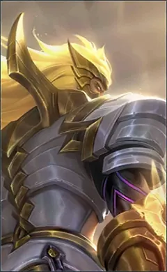

[Roger skins](https://boostmlbb.ru/en/skins/roger.html)

[Skins](https://boostmlbb.ru/en/skins/)/[Roger](https://boostmlbb.ru/en/skins/roger.html)/Grimlock

[Roger skin](https://boostmlbb.ru/en/skins/roger.html)

# Grimlock

GrandTransformersLimited

How to get

Released in the MLBB × Transformers collaboration event. Limited skins come back in event draws from time to time.

Released

24 May 2022

## What the skin changes

-   New look
-   New skill effects
-   Skill sounds
-   Voice-over
-   Showcase animation
-   Showcase scene
-   Showcase music
-   Special actions
-   Attribute bonus

## All Roger skins [8](https://boostmlbb.ru/en/skins/roger.html)

[GrimlockGrand · 2022](https://boostmlbb.ru/en/skins/roger/grimlock.html)[Phantom RangerDeluxe · 2021](https://boostmlbb.ru/en/skins/roger/phantom-ranger.html)[Fiend HunterGrand · 2021](https://boostmlbb.ru/en/skins/roger/fiend-hunter.html)[Cyborg WerewolfDeluxe · 2021](https://boostmlbb.ru/en/skins/roger/cyborg-werewolf.html)[Phantom HunterDeluxe · 2018](https://boostmlbb.ru/en/skins/roger/phantom-hunter.html)[AnubisExceptional · 2018](https://boostmlbb.ru/en/skins/roger/anubis.html)[Dr. BeastExquisite · 2017](https://boostmlbb.ru/en/skins/roger/dr-beast.html)[Dark GentCommon · 2017](https://boostmlbb.ru/en/skins/roger/dark-gent.html)

## Transformers series

[BumblebeeX.Borg · 2025](https://boostmlbb.ru/en/skins/x-borg/bumblebee.html)[Optimus PrimeJohnson · 2023](https://boostmlbb.ru/en/skins/johnson/optimus-prime.html)[MegatronGranger · 2023](https://boostmlbb.ru/en/skins/granger/megatron.html)[Soundwave & RavagePopol and Kupa · 2022](https://boostmlbb.ru/en/skins/popol-and-kupa/soundwave-ravage.html)[StarscreamAldous · 2022](https://boostmlbb.ru/en/skins/aldous/starscream.html)

**How much is a rank boost on Roger?**Choose your current and target ranks to see the price here.

[Calculate price](https://boostmlbb.ru/en/order.html?type=hero)

## Frequently asked questions

How to get the Grimlock skin for Roger?

Released in the MLBB × Transformers collaboration event. Limited skins come back in event draws from time to time.

When was Grimlock released?

24 May 2022.

What class is Grimlock?

Grand, Transformers series.
