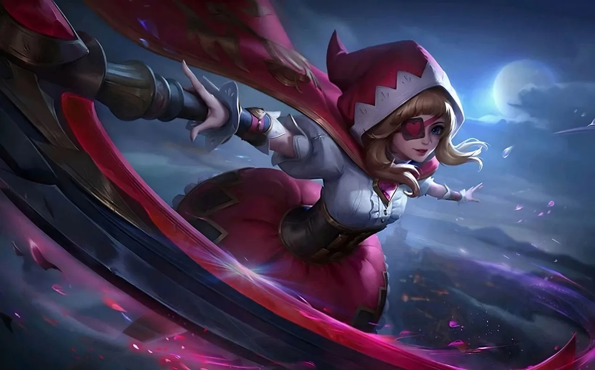

[All skins](https://boostmlbb.ru/en/skins/)

[Skins](https://boostmlbb.ru/en/skins/)/Ruby

# Ruby skins

Skins

10

In the shop

3

Latest

[Neon Edge](https://boostmlbb.ru/en/skins/ruby/neon-edge.html)2025

[Hero profile→](https://boostmlbb.ru/en/heroes/ruby.html)

## All skins

AllGrandExquisiteExceptionalCommon

[Neon EdgeExceptional · 2025](https://boostmlbb.ru/en/skins/ruby/neon-edge.html)[Crescent DervishExceptional · 2025](https://boostmlbb.ru/en/skins/ruby/crescent-dervish.html)[Soul ReaperExceptional · 2024](https://boostmlbb.ru/en/skins/ruby/soul-reaper.html)[Mecha MaidenGrand · 2023](https://boostmlbb.ru/en/skins/ruby/mecha-maiden.html)[Prismatic PlumeExquisite · 2023](https://boostmlbb.ru/en/skins/ruby/prismatic-plume.html)[Pirate ParrotExceptional · 2021](https://boostmlbb.ru/en/skins/ruby/pirate-parrot.html)[Lady ZombieExquisite · 2019](https://boostmlbb.ru/en/skins/ruby/lady-zombie.html)[EdelweissCommon · 2018](https://boostmlbb.ru/en/skins/ruby/edelweiss.html)[Cat GirlCommon · 2017](https://boostmlbb.ru/en/skins/ruby/cat-girl.html)[Hidden Orchid ButterflyCommon · 2017](https://boostmlbb.ru/en/skins/ruby/hidden-orchid-butterfly.html)

**How much is a rank boost on Ruby?**Choose your current and target ranks to see the price here.

[Calculate price](https://boostmlbb.ru/en/order.html?type=hero)

## Frequently asked questions

How many skins does Ruby have?

10 skins, the default look not counted. The newest is Neon Edge (28 February 2025).

Which Ruby skins can you buy now?

Soul Reaper (749 diamonds), Cat Girl (269 diamonds), Hidden Orchid Butterfly (599 diamonds). The other skins were limited and come back only in events.

What is the rarest Ruby skin?

Mecha Maiden, Grand class, The Aspirants series. Released in the The Aspirants event. Limited skins come back in event draws from time to time.
