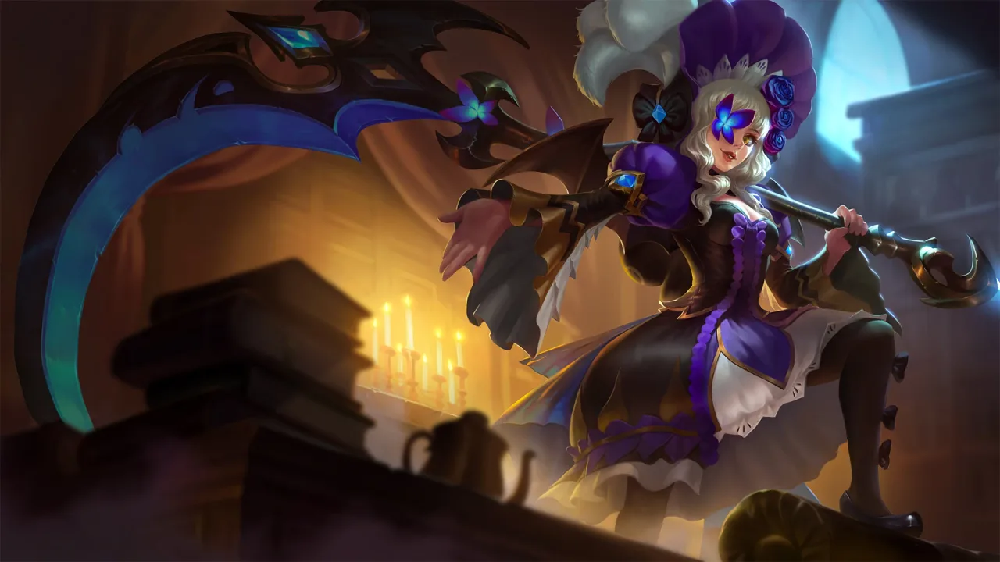

[Ruby skins](https://boostmlbb.ru/en/skins/ruby.html)

[Skins](https://boostmlbb.ru/en/skins/)/[Ruby](https://boostmlbb.ru/en/skins/ruby.html)/Hidden Orchid Butterfly

[Ruby skin](https://boostmlbb.ru/en/skins/ruby.html)

# Hidden Orchid Butterfly

CommonEliteIn the shop

How to get

Sold in the skin shop for 599 diamonds.

Price

599 diamonds

Released

2017

## Painted versions

The same skin in other colours. A painted version needs the skin itself.

-   **Powderblue Butterfly**MCL tournament award.

## All Ruby skins [10](https://boostmlbb.ru/en/skins/ruby.html)

[Neon EdgeExceptional · 2025](https://boostmlbb.ru/en/skins/ruby/neon-edge.html)[Crescent DervishExceptional · 2025](https://boostmlbb.ru/en/skins/ruby/crescent-dervish.html)[Soul ReaperExceptional · 2024](https://boostmlbb.ru/en/skins/ruby/soul-reaper.html)[Mecha MaidenGrand · 2023](https://boostmlbb.ru/en/skins/ruby/mecha-maiden.html)[Prismatic PlumeExquisite · 2023](https://boostmlbb.ru/en/skins/ruby/prismatic-plume.html)[Pirate ParrotExceptional · 2021](https://boostmlbb.ru/en/skins/ruby/pirate-parrot.html)[Lady ZombieExquisite · 2019](https://boostmlbb.ru/en/skins/ruby/lady-zombie.html)[EdelweissCommon · 2018](https://boostmlbb.ru/en/skins/ruby/edelweiss.html)[Cat GirlCommon · 2017](https://boostmlbb.ru/en/skins/ruby/cat-girl.html)[Hidden Orchid ButterflyCommon · 2017](https://boostmlbb.ru/en/skins/ruby/hidden-orchid-butterfly.html)

## Elite series

[Golden OsmanthusChang'e · 2026](https://boostmlbb.ru/en/skins/change/golden-osmanthus.html)[Warlord KingMartis · 2025](https://boostmlbb.ru/en/skins/martis/warlord-king.html)[High Seas CadetKimmy · 2024](https://boostmlbb.ru/en/skins/kimmy/high-seas-cadet.html)[Verdant LancerSilvanna · 2024](https://boostmlbb.ru/en/skins/silvanna/verdant-lancer.html)[Bloodhoof MarauderHylos · 2024](https://boostmlbb.ru/en/skins/hylos/bloodhoof-marauder.html)[Elegant ButterflyGuinevere · 2024](https://boostmlbb.ru/en/skins/guinevere/elegant-butterfly.html)[Marques of BladesLancelot · 2024](https://boostmlbb.ru/en/skins/lancelot/marques-of-blades.html)[Badlands HiatusChip · 2024](https://boostmlbb.ru/en/skins/chip/badlands-hiatus.html)

**How much is a rank boost on Ruby?**Choose your current and target ranks to see the price here.

[Calculate price](https://boostmlbb.ru/en/order.html?type=hero)

## Frequently asked questions

How to get the Hidden Orchid Butterfly skin for Ruby?

Sold in the skin shop for 599 diamonds.

When was Hidden Orchid Butterfly released?

2017.

What class is Hidden Orchid Butterfly?

Common, Elite series.
